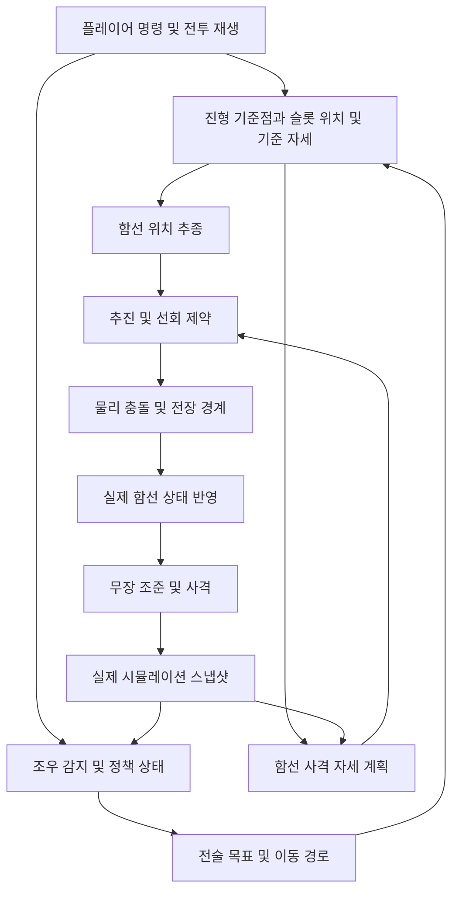

# Fleet Doctrine — 함대 조우 정책 재설계 및 구현 명세

- 작성일: 2026-11-27
- 상태: 구현 기준안 (사용자 확정 요구사항 및 채택된 제안 반영)
- 대상: Fleet Doctrine / Web 시뮬레이션
- 기존 코드 검토 기준: `KimJ6/Fleet-Doctrine`, `main`, commit `d7cf6a7b0b941c3be15436a43c64cc418578494a`
- 기존 기획 기준: `docs/spec/game-design-v2.2.md`
- 독자: Codex 및 후속 개발자

> 이 문서는 구현을 위한 변경 명세다. 기존 기획서 및 코드와 충돌하는 조우 정책·진형·기동·자세 제어에 관한 규칙은 본 문서를 우선한다. 그 외 전투, 점령, 경제, 준비 단계, 렌더링, 물리적 무장 제약 등의 기존 규칙은 유지한다. 코드 변경 전 실제 작업 브랜치를 확인하고, 본 문서에 없는 기능을 임의로 추가하지 않는다.

> **2026-11-28 기동 정책 반영:** 아래 12.3절은 사용자 확정 선체 전방 중심 기동에 따른 변경 설계이며, 이 문서의 이전 횡이동·자세 범위·경로 예측 서술보다 우선한다. 12.3절은 아직 구현 완료가 아닌 설계다. 현재 기본 게임은 기존 이동, `?maneuver=experimental`은 미완성 시험 경로를 사용한다.

## 1. 재설계 목적과 범위

### 1.1. 기획 의도

플레이어는 함대의 이동 명령과 조우 정책을 선택하고, 그에 따른 실제 전술적 행동을 관찰한다. 조우 정책은 상황마다 AI가 최적의 전술을 선택하도록 하는 기능이 아니라, 플레이어가 선택한 전술적 우선순위를 예측 가능하게 수행하는 기능이다.

진형은 외형만 다른 배치 프리셋이 아니다. 각 진형은 공간 배치, 이동 제어, 교전 개시, 개별 함선의 이동 허용 범위 및 조우 종료에서 차별화된다. 복잡한 분기나 예외로 결과를 강제하지 말고, 명확한 공간 규칙과 물리적 제약으로 행동이 자연스럽게 나타나도록 한다.

### 1.2. 확정 요구사항

| 정책 표시명 | 내부 식별자 (기존 유지 권장) | 목적 | 핵심 행동 |
|---|---|---|---|
| 단종진 | `COLUMN` | 기동 | 선두의 실제 이동 경로를 일정 간격으로 추종. 적의 경로 차단이나 전술 이격 12 위반이 예상되면 함대가 협조 제동·정지하고, 차단 해소 시 기존 명령 재개. 자동 우회·전술 후퇴 없음. 가능한 무장은 이동·정지 중 사격. |
| 일자진 | `LINE` | 교전 | 적 방향에 수직인 전면 진형 형성. 거리 24에서 최초 접근 중단. 거리 유지 목적의 후퇴 없음. 사거리 밖 외곽 함선은 추가 접근 및 제한적인 내측 이동을 허용하여 학익진으로 변형. |
| 어린진 | `BREAKTHROUGH` | 돌파 | 전방 반구로만 적 조우 감지. 어린진을 실제로 형성한 뒤 적 배치 영역 돌파. 성공·실패 후 기존 이동 좌표로 이동하되 전방 적 조우 시 돌파 우선. 후방 교전 및 적 함대별 반복 돌파 이력 폐기. |
| 원형진 | `POINT_DEFENSE` | 방어 | 조우 시 지정 거점에 집결해 구형으로 배치. 각 높이의 수평 원 외측을 향하도록 기본 Yaw 설정. 기본 Pitch/Roll 0도. 거점 고정 및 적 추적 금지. |

공통: 사격 자세 변경은 진형 슬롯을 바꾸지 않으며, 실제 선체 자세는 최신 전방 중심 기동의 월드 수평 기준 Pitch·Roll 한계와 각속도 및 충돌 제약을 따른다. 과거 슬롯 기준 각 축 ±90도는 선체 Pitch·Roll의 실제 한계를 확장하지 않는다. 포탑·포신의 별도 제약은 유지한다.

포위진(`ENCIRCLE`)은 폐기 확정이다. 별도 학익진 정책을 추가하지 않는다. 학익진은 일자진의 사거리 기반 변형 결과다. 기존 목적지 이동(`MOVE`), 순찰(`PATROL`)은 유지한다.

### 1.3. 명세의 확정 수준

- **필수:** 위 사용자 확정 조건과 본 문서에서 채택한 공통 규칙. 단종진의 12와 일자진 최초 접근의 24, 최신 선체 기동 제한은 임의 변경하지 않는다.
- **구현 기준:** 거리의 측정 방법, 상태 이름, 후보 생성법, 자료구조 및 실패 처리 등 실제 구현에 필요한 구체화. 동일한 불변식과 테스트를 만족하는 더 단순한 방법이 있으면 대체 가능하다.
- **초기 튜닝값:** 시간, 오차, 예측 길이, 후보 수 등은 검증 전 확정 밸런스가 아니다. 하나의 설정 영역에서 관리하고 테스트 결과로 조정한다. 임시값을 정책 곳곳에 하드코딩하지 않는다.

## 2. 기존 구현의 문제와 변경 근거

소스는 상기 커밋의 정적 검토 결과다. 아래의 구조적 결함과 잠재적 교착은 코드에서 도출했으며, 실행 재현 및 성능 측정은 별도의 검증 작업이다.

| 기존 위치 (`web/simulation.js`) | 확인된 구현 / 문제 | 변경 |
|---|---|---|
| L23–24, L40 | `ENCOUNTER_CONFIG` 및 5종 정책, 공통 조우 런타임 | 정책별 설정 분리, 4종만 지원 |
| L66–77 `planarSlots`, `rawSlots` | 장사진은 YZ 평면, 단종진이 아님. 일자진은 평면 고정. 거점 슬롯은 구면이지만 방향은 공통 Quaternion. 전장 경계에서 슬롯 이동/개별 clamp 가능 | 경로 추종 종렬, 가변 전면 슬롯, 쐐기, 거점 중심 고정 구면과 슬롯별 기준 자세 |
| L80–85 `slots` | 4초 Smoothstep을 실제 진형 완성 여부와 무관하게 적용 | 목표 슬롯과 실제 추종 상태 분리, 실제 오차로 완료 판정 |
| L88–100 `steerMotion` | 목표 위치 방향이 선체 회전 목표를 지배. 별도 사격 자세 결정 기능 없음 | 이동 요구 속도와 자세 요구 분리, 실제 추진 제약 유지 |
| L179–189 `moveAnchor` | 가상 기준점이 실제 함선보다 앞서 갈 수 있음. 진형 안정화 감속은 제한 시간 동안만 적용 | 슬롯 추종 상태 기반 동적 속도 제한, 정책별 이동 완료 판정 |
| L237–242 `makeBreakthroughPlan`, `updateBreakthrough` | 적 방향에 고정된 전방 진입/후방 이탈, `REAR_ENGAGE`, 재관통, 진입 단계 안전거리 교착, 관통 완료 시점의 적 회전 의존 | 현재 접근 방향 기반 돌파, 진형 형성 선행, 적 방향 및 이력 제거 |
| L243–245 `makeGroups`, `updateGroups` | 분견대 목적지와 실제 이동 경로 불일치, 기존 분견대 상태 잔존 위험 | 전면 제거 |
| L246–265 `recognitionRange`, `updateEncounters` | 전방위 조우, 거리/대상 잠금 위주. `LINE`은 적 중심을 직접 목표로 설정하며 공통 제동에 의존. 원형진 도착은 가상 기준점만 확인 | 정책별 감지 및 목표, 일자진 최초 접근 24, 어린진 전방 반구, 실제 거점 구축 판정 |
| L268–282 `updateSafety`, `constrainShipMovement`, `exemptTarget` | 적과 24 이내 접근을 모든 정책에서 차단. 일부 함선 때문에 함대 전체 정지. 돌파 중 대상 함대에 대한 제약 전체 면제 | 전술 이격과 실제 물리 충돌 분리. 단종진에만 12, 일자진에만 최초 접근 24. 실제 충돌은 모든 정책에서 유지 |
| L285–300 `step` | 잔존 `groups`를 참조할 수 있고, 슬롯 추종과 선체 자세 제어가 결합됨 | 전술·진형·자세·추진·충돌 책임 분리, 상태 초기화 일원화 |
| `web/main.js` L58–59, L448–461 | 기존 이름, 설명, 포위 최소 함선 조건, 후방 교전 UI | 4종 명칭 및 상태 UI 갱신 |
| `web/main.js` L140–191 `battleCombat` | 포탑 및 무장 표적 선택/조준은 있으나 진형 기준 독립 선체 자세를 결정하는 명시적 단계 없음 | 선체 자세 계획을 별도 추가. 기존 무장 사거리, 발사각, 차폐, 포구 안전 검사 유지 |

기존 설계 문서의 8장(교전 대응), 9장(대형), 7장(조우 상태), 테스트 및 타입 정의에서 위 변경과 충돌하는 내용을 함께 수정한다. 이전 버전 문서를 무차별적으로 덮어쓰지 말고 보존할 필요가 있으면 archive로 이동한다.

참조 링크:

- [simulation.js 고정 커밋](https://github.com/KimJ6/Fleet-Doctrine/blob/d7cf6a7b0b941c3be15436a43c64cc418578494a/web/simulation.js)
- [main.js 고정 커밋](https://github.com/KimJ6/Fleet-Doctrine/blob/d7cf6a7b0b941c3be15436a43c64cc418578494a/web/main.js)
- [기존 기획서 v2.2](https://github.com/KimJ6/Fleet-Doctrine/blob/d7cf6a7b0b941c3be15436a43c64cc418578494a/docs/spec/game-design-v2.2.md)
- [무장 밸런스](https://github.com/KimJ6/Fleet-Doctrine/blob/d7cf6a7b0b941c3be15436a43c64cc418578494a/data/balance/weapon_types.csv)

## 3. 공통 설계 원칙 및 정보 책임

### 3.1. 계층과 데이터 흐름



| 책임 | 입력 | 출력 / 금지 사항 |
|---|---|---|
| 명령 관리 | 사용자 명령 | 이동 목표, 순찰 인덱스, 정책, 간격, 거점. 조우 중 목표를 임의로 덮어쓰지 않음 |
| 공간 감지 | 실제 생존 함선 위치, 속도, 방향 | 주변 적 후보, 경로 방해 후보. 무장별 검색과 분리 |
| 정책 제어 | 명령, 공간 정보, 런타임 | 전술 목표, 진형 종류, 이동 허용 조건, 단계 전환. 실제 함선을 직접 이동시키지 않음 |
| 진형 제어 | 전술 목표, 실제 슬롯 오차 | 기준점, 기준 자세, 슬롯별 목표 위치·속도·기준 Quaternion |
| 함선 위치 제어 | 슬롯 및 실제 위치/속도 | 요청 이동 속도 및 가속도 |
| 함선 자세 제어 | 슬롯 기준 자세, 사격 후보, 이동 요구 | 허용 범위 내 목표 선체 자세 |
| 물리/충돌 제어 | 이동 및 자세 요구, 충돌 자료 | 가능한 실제 기동. 전술 목적을 직접 변경하지 않음 |
| 무장 제어 | 실제 선체 위치/자세 | 기존 포탑 조준, 사거리/차폐/포구 검사, 발사 및 피해 |
| UI/렌더링 | 읽기 전용 상태 | 모델, 미리보기, 상태 표시. 권위적 전술 판단 금지 |

### 3.2. 좌표계 및 용어

- 월드 Y축이 위쪽, XZ가 수평면. 함선 로컬 +Z가 전방(기존 코드 관례).
- `anchor`: 진형 제어를 위한 가상 기준점. `actualCenter`: 생존 함선 실제 위치의 평균 또는 명시된 실제 대표점. 두 값을 혼동하지 않는다.
- `formationForward`: 진형의 기준 전방. 개별 함선의 실제 조준 방향과 독립.
- `slotPosition`: 개별 함선의 목표 월드 위치. `slotBaseRotation`: 그 슬롯의 기준 자세.
- `ship.position`, `ship.velocity`, `ship.rotation`: 실제 권위 데이터. 렌더링 모델이나 미리보기로부터 역산하지 않는다.
- 정책 거리 12 및 24는 프로토타입 월드 단위. 함선 중심 기준으로 측정한다. 충돌 반경 및 선체 크기는 별도 제약이다.
- 탐지/충돌/사거리 계산은 3차원에서 수행. 원형진의 기본 자세 계산에만 의도적으로 XZ 투영을 사용한다.

### 3.3. 공통 불변식

1. 원래 이동 명령 및 순찰 인덱스는 조우 중 보존한다. 종료 후 현재 사용자 명령으로 복귀한다. 순찰 인덱스를 조우 이동 좌표로 갱신하지 않는다.
2. 사격 가능 여부가 실제 발사를 보장하지 않는다. 사거리, 포각, 차폐, 포구 안전, 쿨다운은 독립적으로 검증한다.
3. 단종진은 모든 함선 사거리 확보 요구에서 제외. 일자진은 모든 함선이 가능한 한 교전에 참여하도록 이동을 허용한다. 어린진과 원형진은 각자의 이동/위치 우선순위를 깨뜨려 사거리를 확보하지 않는다.
4. 사격 목적의 자세 변경은 모든 정책 및 상태에서 허용하되 실제 위치 슬롯을 변경하지 않는다. 정책에 맞는 추진·선회 제약을 준수한다.
5. 실제 선체 충돌은 적/아군 및 모든 정책에 대해 예방한다. 어린진도 예외가 아니다. 기존 적 24 강제 제한과 돌파 시 면제 방식은 제거한다.
6. 모든 함선이 실제 목표 슬롯에 도달했는지 판정할 때 가상 기준점의 도착만으로 성공 처리하지 않는다.
7. 함선의 배치 순서와 사용자 지정 간격을 가능한 한 보존한다. 사망 슬롯 유지가 기본이며, 정책에 필수적인 재구성(예: 단종진 선두 교체)은 예외다. 전투 중 임의 전원 재번호 금지.
8. 정책 전환 및 종료 시 해당 정책 런타임(경로, 완료 플래그, 잠금된 축, 변위 등)을 일원화하여 정리한다. 준비 단계 진입만으로 활성 정책 진행을 리셋하지 않는다. 명령 변경은 revision으로 구별한다.
9. 전술 정책에서 실제 이동이 불가능하면 제한된 재계획, 감속, 대기 또는 실패를 처리한다. 좌표를 강제로 clamp하여 진형을 순간이동시키거나 성공으로 판정하지 않는다.
10. 모든 정책은 전투 최초 재생 시 적 조우와 무관하게 진형 슬롯을 생성하고 실제 함선의 형성을 시작한다. 조우는 전술 전환의 계기이며 진형 생성의 선행 조건이 아니다. 변경 없는 일시정지 후 재생은 진행 상태를 유지한다.

### 3.4. 권장 런타임 데이터 (의사 타입, 언어 강제 아님)

```ts
type Policy = 'COLUMN' | 'LINE' | 'BREAKTHROUGH' | 'POINT_DEFENSE';

type FormationSlot = {
  shipId: ShipId;
  localOffset: Vec3;          // 정적 템플릿, 정책에 따라 미사용 가능
  worldPosition: Vec3;        // 실제 추종 목표
  worldVelocity: Vec3;        // 기준점 이동 + 회전 + 변형을 반영한 목표 속도
  baseRotation: Quat;         // 사격 자세의 참조 프레임
  arrived: boolean;
};

type FleetRuntime = {
  commandRevision: number;
  policyRevision: number;
  phase: string;             // 정책별 상태 (아래 명세)
  anchor: Vec3;
  anchorVelocity: Vec3;
  formationRotation: Quat;
  actualCenter: Vec3;
  slots: FormationSlot[];
  formationReadiness: number;
  phaseElapsed: number;
  contact: { present: boolean; absentTime: number; stableTime: number };
  policyRuntime: ColumnRuntime | LineRuntime | WedgeRuntime | DefenseRuntime;
  reason: string | null;
};
```

기존 JS 객체 구조에 맞춰 구현한다. 타입 도입을 위해 프로젝트 전체를 TypeScript로 전환하지 않는다. 정책 상태의 유효성을 판별 가능한 형태로 유지한다. 어린진에는 적 함대별 돌파 이력 또는 재관통 잠금 맵을 두지 않는다.

### 3.5. 시뮬레이션 갱신 순서

```text
fixedStep(dt):
    생존 함선의 실제 위치/속도/자세 스냅샷 생성
    공통 이동 전 공간 인덱스 갱신 및 버전 확정
    명령/편성 revision 처리, 최초 재생 시 진형 슬롯 생성
    필요 시 인접 후보 쌍 생성 및 공통 결과 공유
    저주기: 조우 후보, 경로 방해, 사거리, 정책 목표 갱신
    매 틱: 정책 진행/실패/완료 평가 및 진형 기준점 제어
    슬롯의 월드 위치/속도/기준 자세 갱신
    저주기: 선체 사격 자세 후보 평가 및 목표 자세 갱신
    매 틱: 함선 슬롯 추종, 선회/추진/충돌 해결 (스냅샷 참조)
    모든 실제 상태를 일관되게 반영
    이동 후 공간 인덱스 갱신 및 버전 확정
    기존 무장 조준 및 사격/피해/점령 처리
    시간 갱신 및 UI용 상태 발행
```

이동 및 회전은 기존 고정 틱 60Hz 유지. 후보 검색 및 전술 재평가는 기존 `scanTicks=12`(5Hz) 재사용 권장. 물리 충돌 및 유효하지 않은 대상 제거는 저주기 검사로만 제한하지 않는다. 결정적 정렬 및 동점 처리로 같은 입력에서 같은 결과를 유도한다.

## 4. 공통 진형 이동 및 자세 제어

### 4.1. 슬롯 생성과 전환

기본적인 고정 진형 슬롯 계산은 다음과 같다.

```text
slotWorld = anchor + rotate(formationRotation, localOffset)
```

단종진은 경로상의 슬롯, 일자진은 슬롯별 추가 변위, 원형진은 고정 월드 거점 슬롯으로 이를 확장한다. 새 진형 생성 시 실제 함선 위치는 그대로 유지하고 목표 슬롯만 변경한다. 사용자 배치 순서를 우선 보존하며, 불필요한 경로 교차를 줄이는 할당은 정책의 순서 제약 내에서만 허용한다.

슬롯이 이동할 때는 목표 속도를 함께 제공한다. 슬롯 추종 속도 요청은 다음 형태를 권장한다.

```text
positionError = slot.position - ship.position
velocityRequest = slot.velocity + Kp * positionError
velocityRequest = clampToSpeedBudget(velocityRequest)
```

`slot.velocity`는 기준점 속도뿐 아니라 진형 회전과 슬롯 변형의 속도도 반영한다. 오차가 큰 경우 급가속 대신 제한된 속도로 추종한다. 형성 중 또는 추종이 크게 지연된 경우 기준점의 속도를 감속하고 필요하면 기다린다. 이 동기화는 고정 시간 이후 무조건 해제하지 않는다.

### 4.1.1. 전투 재생 시 진형 형성과 변경 처리

- 전투 최초 재생의 첫 시뮬레이션 틱에서 네 정책 모두 현재 편성과 선택된 진형으로 목표 슬롯을 만든다. 적이 없어도 형성과 명령 수행을 시작한다. 실제 위치를 순간 변경하지 않는다.
- 단종진은 선두 경로 기반 종렬, 일자진은 진행 방향에 수직인 전면, 어린진은 현재 진행 방향 기준 쐐기, 원형진은 이동하는 함대 기준점을 중심으로 구면을 만든다. 진행 방향이 없으면 마지막 유효 함대 방향, 그것도 없으면 초기 함대 방향을 쓴다.
- 원형진의 이동 중 구면은 움직이는 기준점을 따른다. 적 조우 시에만 8절에 따라 방어 거점을 선정·고정하고 해당 거점의 슬롯으로 이행한다. 이동 중 구면 완성은 거점 구축 완료가 아니다. 적을 추적하거나 조우 전 상시 고정 방어로 전환하지 않는다.
- 기준점은 원래 이동 명령을 수행하되 슬롯 오차, 함선의 선회/추진 능력 및 충돌 상황에 따라 속도를 제한한다. 무조건 전원 형성 완료를 기다리지는 않지만 안전이나 선두 이탈 방지를 위해 정지할 수 있다. 어린진의 돌파 개시는 별도 준비 조건을 반드시 충족한다.
- 일시정지와 변경 없는 재생은 슬롯 할당, 실제 진행도, 조우 및 돌파 상태를 초기화하지 않는다. 정책·간격·명령·편성 변경은 해당 revision을 비교해 영향받는 목표만 갱신한다. 명령 변경만으로 무조건 슬롯을 재할당하지 않는다.
- 격침 시 기존 슬롯을 기본적으로 유지한다. 신규 함선 투입 또는 사용자 편성 변경 시 기존 순서와 생존 슬롯을 가능한 한 보존하면서 유효한 슬롯을 배정한다. 진형 목표가 바뀌어도 함선을 순간이동시키지 않는다. 물리적으로 배치할 수 없다면 대기/실패 사유를 기록한다.

### 4.2. 실제 진형 형성 판정

```text
positionOK_i = distance(ship.position, slot.position) <= positionTolerance
velocityOK_i = length(ship.velocity - slot.velocity) <= velocityTolerance
readyRatio = count(alive && positionOK && velocityOK) / aliveCount
```

어린진에서는 진형 형성이 돌파 개시의 선행 조건이다. 원칙적으로 모든 생존 함선이 허용 오차에 들어오도록 한다. 교착 방지를 위해 준비 비율 기준과 최장 지연 함선 오차의 상한을 함께 둘 수 있다. 이 완화는 진형이 형성되지 않은 상태에서 돌파하기 위한 무조건 시간 초과 예외가 되어서는 안 된다. 기동이 불가능하면 실패 처리한다.

초기 제안: 기존 위치 0.8, 상대 속도 0.5 오차를 시작점으로 재사용하고, 0.3~0.5초 안정 유지 후 완료 처리. 준비 비율 1.0을 기본으로 하며 완화 필요 시 별도 검증한다. 기준 자세 대비 합법적인 사격 편차는 형성 실패로 간주하지 않는다. 돌파 시작에 필요한 실제 추진 가능성은 별도 평가한다.

### 4.3. 실제 물리 충돌과 전술 이격의 분리

정책에서 사용하는 12 또는 24는 선체 충돌 반경이 아니다. 실제 충돌은 기존 함선 충돌 반경/콜라이더 자료를 사용하여 아군과 적 모두에 대해 예방한다. 필요하면 안전 여유를 더한 보수적 경계 구를 broad phase로 사용한다. 후보의 현재 속도를 반영한 swept sphere 또는 상대 이동 선분 검사를 적용하여 빠르게 이동하는 두 함선의 교차를 막는다.

```text
physicalMinDistance(i,j) = collisionRadius_i + collisionRadius_j + collisionMargin
```

실제 크기 데이터가 없으면 검증된 기본 반경으로 임시 근사하고 로그에 기록한다. 기존 `STANDOFF_DISTANCE`를 반경 대신 사용하지 않는다. 분리 벡터만 더하는 소프트 회피는 충돌 방지의 유일한 수단이 될 수 없다. 충돌 제한으로 이동할 수 없는 경우 정책에 교착 정보를 반환한다. 기준점은 실제 함선이 막힌 상태에서 계속 성공 위치로 나아가지 않는다.

### 4.4. 슬롯 기준 독립 사격 자세 (모든 정책)

> 아래의 슬롯 상대 ±90도 및 횡방향 추진 설명은 이전 설계 기록이다. 실제 선체의 Pitch·Roll과 항법/사격 자세 우선순위는 최신 사용자 기동 정책 및 12.3절을 따른다. 아래 구현 이력은 기존 기본 경로에 관한 설명이다.

슬롯마다 기준 Quaternion `Qbase`를 정의한다. 개별 함선의 실제 자세 `Qship`는 기준 자세에 상대 회전을 적용한 값이다.

```text
Qrelative = inverse(Qbase) * Qship
Qdesired  = Qbase * QrelativeDesired
```

사용자 요구는 축별 ±90도 제한이다. 전체 Quaternion 최단 회전각을 90도로 제한하거나 전방축 내적만 제한하는 방식으로 대체하지 않는다. 합성 자세의 전체 회전각이 90도를 넘는 것은 축별 제한과 모순되지 않는다.

구현 시 고정된 상대 Euler 회전 순서(권장 `YXZ`: Yaw Y, Pitch X, Roll Z)를 한 곳에서 명시한다. 상대 Yaw/Pitch/Roll 파라미터를 연속적으로 유지하고 각 값을 [-90°, 90°]에 제한한다. 실제 Quaternion은 이 파라미터로 구성한다. 매 틱 Euler 재분해만 반복하여 ±90도 근방에서 분기나 짐벌락으로 자세가 튀는 구현은 피한다. 기준 프레임 변화까지 포함해 실제 선체의 회전량이 선회율 한계를 넘지 않도록 기준 프레임 갱신 및 자세 추종 속도를 조율한다. 경계에서 수치 오차 허용치를 두되 범위 위반을 정상화하지 않는다.

| 진형 | 기준 자세 |
|---|---|
| 단종진 | 해당 슬롯의 추종 경로 접선과 연속적인 Up 벡터 |
| 일자진 | 전면 진형의 법선(적 방향) 및 안정된 Up 벡터 |
| 어린진 | 이동 중 진행 방향, 조우 후 준비 단계에서 결정하고 돌파 개시 시 잠근 돌파축 |
| 원형진 | 슬롯 높이의 수평 원 외측 방향, 월드 Up, Pitch/Roll 0 |

사격 자세 선택은 실제 무장 구성과 사거리 내 적 후보를 이용한다. 최소 구현은 현재 자세, 기준 자세, 적 방향을 향한 제한적 상대 자세, 주요 측면 무장 방향을 정렬할 후보 등을 평가하고, 사거리/대략적인 화각에 들어오는 무장 화력, 회전 비용, 추진 효율, 슬롯 추종 오차로 점수화한다. 기존 자세와 비슷한 후보를 선호하는 작은 안정성 보너스를 두어 반복 회전을 줄인다. 반드시 후보에서 Roll을 배제하지 않는다. 제한된 후보 평가로 시작하고 모든 후보마다 고비용 메시 차폐/포구 검사를 실행하지 않는다. 실제 발사는 기존 정밀 안전 검사에서만 허가한다.

현재 구현은 함선 생성 시 무장별 허용 선회·고각에서 포구 방향을 미리 표본화하고, 자세 후보 평가 시 대상 방향이 표본에 가까운지를 확인한다. 선회는 45도, 고각은 15도 간격으로 표본화하며 양 끝과 중립 각도도 포함한다. 이는 화각의 근사 평가이므로 실제 도달 경로와 차폐까지 보장하지 않는다. 포탑 이동 제한, 자기 선체 차폐와 아군 선차단은 실제 사격 과정에서 별도로 판정한다. LC01 실제 모델의 포구 변환과 차폐·선차단을 검증했으며, 다른 함종의 실측 검증은 별도로 필요하다.

위치 제어가 선체 방향을 다시 강제로 덮어쓰지 않도록 `steerMotion`을 분리하거나 수정한다. 실제 자세를 기준으로 이동 요청을 로컬 속도로 변환하여 전진/후진/횡이동 속도 예산과 가속도를 적용한다. 기존 전방 추진 1.0, 측면/후진 0.5 비율을 변경할 필요는 없다. 사격 자세 후보는 이동 목적과 양립할 수 있는 후보를 우선한다. 장거리 이동 또는 돌파에서도 사격 목적의 회전 자체를 비활성화하지 않는다. 물리적으로 슬롯 유지와 원하는 자세가 양립하지 않으면 추진 가능한 자세를 선택하며, 독립 사격 자세의 허용 범위 자체는 유지한다.

## 5. 단종진 (`COLUMN`)

### 5.1. 목적 및 배치

기존 이동 목표 도달이 최우선이다. 함선은 종렬로 배치되고 선두를 따라 순차적으로 선회한다. 적을 공격하기 위해 이동 목표를 변경하지 않는다. 후방 함선이 사거리 밖에 있더라도 기다리거나 추가 접근하지 않는다. 사격 가능한 무장만 독립적으로 사격한다.

기존 YZ 평면 배치를 폐기한다. 경로를 누적 호길이 `s`로 매개변수화하고, 충돌 처리 후 선두 함선이 실제로 이동한 경로 `P(s)`를 기록한다.

```text
slot_i.position = P(sLead - cumulativeGap_i)
slot_i.baseForward = tangent(P, sLead - cumulativeGap_i)
```

함선 간격은 시간차가 아닌 경로 거리 기준이다. 기존 사용자 지정 전후 간격을 적용하되 선체 최소 충돌 거리를 충족해야 한다. 급커브에서 호길이 간격이 실제 직선 간격을 보장하지 않으므로 곡률/최소 선회 반경과 충돌 검사를 함께 적용한다. 초기 이력은 실제 초기 배치 또는 출발 방향 뒤쪽으로 연장된 유효 경로로 생성한다. 선두가 정지해도 후속 함선은 자신의 슬롯에 수렴한다. 선두 격침 시 다음 생존 함선으로 선두 역할을 이전하되 기존 경로를 보존하고 순간이동하지 않는다.

### 5.2. 상태

| 상태 | 행동 | 다음 조건 |
|---|---|---|
| `TRAVEL` | 기존 목적지/순찰 경로를 선두와 후속 함선이 추종하고 가능한 무장으로 사격 | 차단 또는 계속 진행 시 12 위반 예상 → `BRAKE` |
| `BRAKE` | 함대 기준 진행과 개별 함선 추진을 기동 한계 안에서 협조 감속. 사격 계속 | 실제 함선들이 정지 조건에 도달 → `HOLD` |
| `HOLD` | 함대 진행 대기, 가능한 무장 사격, 기존 경로의 차단 재평가 | 차단 해소와 재개 경로 확인 → `TRAVEL` |

전술 경로에는 `BYPASS` 상태가 없다. 계획 평가·사격·선두 승계 및 물리 안전 감시는 정지 중에도 지속한다. 차단이 예상되는 동안 실제 함선이 아직 감속 중일 수 있으므로 정지로 즉시 판정하지 않는다.

### 5.3. 진행 차단·협조 제동·재개

1. 현재 이동/순찰 명령이 만든 선두 경로와 후속 함선의 추종 영역을 기준으로 공통 공간 인덱스에서 관련 적을 수집한다. 경로와 무관한 측후방 적만으로 진행을 중단하지 않는다. 상대 이동과 검사 주기의 지연을 고려한다.
2. 각 생존 함선의 실제 위치·속도·선수 방향·추진 상태, 제동 능력 및 예상 상대 이동을 사용해 **기존 경로를 계속 추종할 때**의 적 중심 최소 거리와 물리 충돌을 평가한다. 전술 기준은 기존 값 12이며 물리 반경은 별도로 검사한다. 검증이 불충분하면 안전으로 판정하지 않고 제동·재평가한다.
3. 경로가 차단되거나 계속 진행 시 12 위반이 예상되면, 함대 기준점과 각 함선이 제동 거리·선회·종렬 간격을 고려해 충분히 일찍 협조 감속한다. 후속 함선은 선두 기록 경로와 간격을 유지하도록 제어하며, 함대 기준점이나 선두만 정지시키고 나머지가 무조건 정지점으로 몰리지 않도록 한다. 기동 제약을 우회한 즉시 정지나 순간 위치 변경은 금지한다.
4. 적을 피하기 위한 자동 우회 경로와 전술적 후퇴는 생성하지 않는다. 적이 스스로 12 안으로 접근하거나 초기 이격이 부족할 때는 이격을 항상 보장한다고 주장하지 않고 물리 충돌 방지를 우선하며 원인을 기록한다. 초기 배치·허용된 근거리 위치 조정 및 물리 충돌의 비상 보정은 전술 후퇴와 구분하되 적 회피 우회를 우회적으로 도입하지 않는다.
5. 동일한 기존 경로가 다시 안전해지면 짧은 안정 조건을 거쳐 기존 목적지 또는 순찰 구간을 재개한다. 정지 및 재개는 사용자 명령을 변경하지 않는다. 사용자 명령에 따른 새로운 목적지·순찰 선회는 적 회피를 위한 자동 우회와 구분한다.

물리 충돌 검사는 모든 함선에 매 틱 수행한다. 긴급 충돌 방지는 전술 이격의 12와 별도이며, 이동 중과 대기 중에도 포각·아군 차폐 등 기존 사격 조건을 만족하는 무장은 교전한다.

## 6. 일자진 (`LINE`)

### 6.1. 목적 및 배치

일자진의 목적은 적을 향해 전면을 펼치고 가능한 모든 함선이 사격에 참여하도록 하는 것이다. 거리 유지나 자동 후퇴는 목적이 아니다. 전면의 기준 평면은 로컬 XY이며 +Z가 적 방향을 향한다. 기존 평면 슬롯 생성은 재사용하되, 외곽 함선의 추가 접근을 지원하는 가변 슬롯으로 확장한다.

조우 전에는 진행 방향에 수직인 전면 진형을 형성하면서 기존 이동 명령을 수행한다. 조우 시 해당 명령을 일시 중단하고 이미 형성 중인 전면 진형을 적 방향으로 선회시키며 접근한다. 모든 함선의 사격 기회 확보는 이동 제어의 목표이지만 실제 발사각과 차폐까지 충족할 때까지 무한 접근하는 의미는 아니다.

### 6.2. 상태 및 24 단위 접근 정지

| 상태 | 행동 | 다음 조건 |
|---|---|---|
| `TRAVEL` | 전면 진형을 형성·유지하며 기존 이동 명령 수행 | 적 조우 -> `APPROACH` |
| `APPROACH` | 전면 진형 형성 및 접근 | 전면 거리 24 도달 -> `ENGAGE` |
| `ENGAGE` | 기준점 정지, 사격, 외곽 슬롯 추가 접근 | 실제 교전 가능 적이 없어지고 적이 멀어짐 -> `REAPPROACH`; 조우 종료 -> `TRAVEL` |
| `REAPPROACH` | 유효한 적을 향해 재접근 | 거리 24 도달 -> `ENGAGE`; 조우 종료 -> `TRAVEL` |

24는 함대 전체가 유지해야 할 고정 거리대가 아니라 **기준점에 대한 최초 접근 중단 기준**이다. 구현 기준으로 전면 기본 슬롯 또는 해당 슬롯을 추종하는 실제 생존 함선과 전방 적 함선 간 최단 중심 거리를 사용한다. 함대 중심 간 거리나 경계 구 반경 차이로 대체하지 않는다. 슬롯이 아직 형성 중이라면 실제 위치를 함께 확인하여 선두 함선만 과도하게 앞서 나가지 않도록 감속한다. 거리가 24 이하이면 추가 집단 전진을 멈추고, 이미 24 미만이면 이격을 위해 후퇴하지 않는다. 적이 움직여 거리가 다시 24를 초과하더라도 아직 사격 기회가 있다면 자동 재접근하지 않는다. 재접근은 교전 사거리에서 이탈해 교전 지속이 불가능할 때만 허용한다.

24 도달을 위해 이동 방향을 적과 연결된 축으로 제한할 필요는 없지만 실제 이동 경로와 진형의 전면 방향은 서로 일관되어야 한다. 목표 전면 거리에 대한 제동 거리 및 추정 적 속도를 고려해 접근 속도를 낮춘다. 상대가 직접 접근하는 경우 24 미만이 되는 것을 물리적으로 막는 정책은 아니다.

### 6.3. 학익진 변형: 가변 슬롯

기본 슬롯 `P_i`, 진형 전방 단위벡터 `F`, 진형의 평면 중앙 `Cplane`으로부터 변형 슬롯을 계산한다.

```text
P'_i = P_i + forwardOffset_i * F + inwardOffset_i * I_i
forwardOffset_i >= 0
inwardOffset_i >= 0
I_i = normalize(projectToPlane(Cplane - P_i, F))
```

내측 방향이 정의되지 않는 중앙 슬롯은 `inwardOffset=0`으로 처리한다. 변형은 진형 전체에 대한 상대 위치 변경이지 개별 함선의 적 추격 명령이 아니다. 좌우 및 상하 외곽 모두 같은 규칙을 사용한다. 기본 평면을 이루는 중앙 함선들이 정지한 상태에서 사거리 밖 외곽 함선이 전방으로 이동하여 자연스럽게 오목한 학익진/곡면을 형성한다.

#### 사거리 평가

함선별 실제 활성 무장 데이터에서 최대 유효 사거리를 추출한다. 무장이 없는 함선은 접근만 반복하지 않도록 비전투 함선으로 처리한다. 우선 한 개 이상의 작동 가능한 무장이 적에게 닿는 거리 확보를 이동 조건으로 사용한다. 모든 무장의 최대 사거리 평균이나 전역 `CONFIG.weaponRange`를 함선별 사거리로 대체하지 않는다.

사거리 계산은 실제 적 함선 위치를 사용하며 적 함대 중심만 사용하지 않는다. 근사 거리 평가와 실제 포구 기준 발사 가능 여부는 분리한다. 현재 LC01 예시의 32/40 범위는 CSV로부터 읽고 하드코딩하지 않는다. 조준 각도, 쿨다운, 일시적인 차폐만으로 사거리 부족이라 판단하지 않는다.

#### 전방 추가 접근 계산

현재 기본 슬롯에서 적 위치 `E`까지 벡터 `v = E - P_i`를 구한다. 진형 전방 성분 `a = dot(v,F)`와 평면 성분 `b = v - a*F`를 구한다. 해당 무장 사거리 `r`에 들어가기 위한 최소 전방 이동은 다음과 같다.

```text
if length(v) <= r: forwardNeeded = 0
else if a > 0 and length(b) <= r:
    forwardNeeded = max(0, a - sqrt(r*r - dot(b,b)))
else:
    forwardNeeded = UNREACHABLE_BY_FORWARD_ONLY
```

사거리 경계에서 작은 수치 오차로 상태가 반복 변경되지 않도록 진입 시 약간의 여유 및 재평가 유예를 적용할 수 있다. 목표값은 물리 및 진형 제한으로 검증하고 실제 이동은 속도 제한을 적용한다. 전방 이동만으로 해결 가능한 후보가 여러 개면 이동량이 작고 이전 목표와 일관되며 안전한 후보를 선택한다. 대상은 개별 함선의 이동 제어를 위한 임시 위치 후보이며 무장 표적을 강제로 지정하지 않는다.

#### 제한적인 내측 이동

전방 추가 이동만으로 사거리를 확보할 수 없는 외곽 함선에 한해 내측 이동을 허용한다. 좌우·상하 슬롯 순서가 뒤집히거나 중앙으로 과밀해지지 않도록 한다. 가능한 후보를 내측 방향으로 소량 이동시킨 뒤 위 수식을 다시 적용한다. 두 변위를 동시에 평가하되 최소 변위가 유효한 후보를 우선한다.

다음 제한을 준수한다.

- 내측 이동은 사용자 지정 슬롯 간격과 실제 최소 충돌 간격을 바탕으로 제한한다. 초기 탐색 상한은 기본 슬롯에서 인접 간격의 절반 수준으로 시작하되 실측 충돌 여유로 더 엄격히 제한한다.
- 전방 이동 상한은 기본 전면과 적 배치 영역 사이의 여유 및 진형 규모에 따라 정한다. 학익진의 개별 함선이 적 배치 영역을 지나치거나 독립 추격하는 것을 금지한다. 물리적으로 가능한 접근이 없으면 현재 유효한 위치에서 대기한다.
- 단종진 전용 거리 12를 복제해 강제하지 않는다. 일자진의 24도 개별 외곽 함선의 사격 접근을 차단하는 공통 제약으로 쓰지 않는다. 실제 물리 충돌은 예외 없이 방지한다.
- 후보 검증은 적/아군 충돌, 전장 경계, 인접 슬롯과의 거리, 배치 순서, 이동 경로를 고려한다. 좌표를 서로 독립적으로 clamp하는 방식은 금지한다.

#### 변형 유지 및 복귀

사거리 및 기존 슬롯 변위를 유지하는 중에도 저주기마다 현재 위치에서 기존 목표까지의 상대 이동 경로를 재검사한다. 새 장애물로 경로가 차단되면 해당 함선의 목표를 현재 위치로 고정하고 안전한 대체 변위를 평가한다. 유효한 후보가 없으면 대기하며 장애물이 사라지면 재평가한다. 이 과정에서 함선 위치를 순간 이동시키지 않는다.

사거리에 도달하면 해당 함선의 추가 전진을 멈춘다. 기본 슬롯으로 즉시 되돌리면 다시 사거리 밖으로 나갈 수 있으므로 `forwardOffset`, `inwardOffset`을 유지한다. 적이 가까워졌다는 이유로 기존 거리 확보를 위해 후퇴하지 않는다. 적이 이동해 기존 변형 위치에서도 더 이상 사격할 수 없다면 허용 범위 내에서 변위를 갱신한다. 새로운 후보가 없으면 진형을 유지한다. 집단 재접근/정책 변경/조우 종료 시 필요한 경우 새 기본 진형으로 완만히 복귀한다. 수동 이동 명령에 의한 복귀는 금지된 거리 유지 후퇴와 구별한다.

```text
updateLine(snapshot):
    if contactEnded: releaseOffsetsAndResumeMovement(); return
    if phase == APPROACH or phase == REAPPROACH:
        formFrontPlaneAndApproachUntilDistance24()
    if phase == ENGAGE:
        holdAnchorPosition()
        for ship in aliveShipsStableOrder:
            if hasEnemyInRange(ship.actualPosition):
                retainCurrentValidOffset(ship)
            else:
                proposal = findMinimalSafeForwardOffset(ship)
                if none: proposal = findBoundedInwardAndForwardOffset(ship)
                if proposal: setValidatedSlotOffset(ship, proposal)
        if fleetCannotContinueEngagementBecauseEnemyMovedAway:
            beginReapproach()
```

함대 전체의 재접근을 개별 외곽 함선의 사거리 실패만으로 발동하지 않는다. 진형 방향의 변경은 적의 위치 변화를 반영하되 선회율과 슬롯 추종 가능성으로 제한한다. 이미 사거리 내인 함선에 대한 불필요한 추가 이동이 발생하지 않도록 검증한다.

## 7. 어린진 (`BREAKTHROUGH`)

### 7.1. 목적 및 삭제 대상

적의 후방을 점유하는 것이 아니라, 어린진을 먼저 완성한 후 정면에 존재하는 적의 배치 영역을 돌파한다. 돌파 성공 또는 실패 이후 기존 목적지/순찰 목표로 이동한다. 이동 중 전방에 적이 조우하면 목적지보다 돌파를 우선한다.

기존 `REAR_ENGAGE`, 적 함대 전방/후방 방향 판정, 후방 체류점, 재관통 샘플, 재관통 이력 및 적 함대별 완료 잠금을 제거한다. 적 함대를 구별하여 재돌파 허용 여부를 결정하지 않는다. 동일 적이 다시 전방에 나타나면 새 조우가 성립할 수 있다.

### 7.2. 조우 개시: 전방 반구

기존 공간 인덱스에서 탐지 반경 내 후보를 찾은 뒤 함대 기준 방향에 대한 내적으로 필터링한다. 조우의 중심은 실제 생존 함선 중심으로 하고, 방향은 개별 함선 조준 자세와 무관한 `formationForward`를 사용한다. 조우 반경은 기존 recognitionRange를 시작점으로 하되 형성에 필요한 시간과 이동 속도를 고려해 설정한다. 기존 고정 38/48을 새 반구 탐지와 혼용하지 않는다.

```text
v = enemyShip.position - actualCenter
withinRadius = dot(v,v) <= encounterRadius^2
inForwardHemisphere = dot(v, formationForward) >= 0
isContact = enemyShip.alive && isHostile && withinRadius && inForwardHemisphere
```

경계 90도는 반구에 포함한다. 정확히 중심과 일치하거나 방향이 정의되지 않는 경우 물리 충돌 처리 및 마지막 유효 진형 방향을 사용한다. 전방에 적 함선이 한 척이라도 있는 경우 조우 후보가 된다. 적 함대 중심만 필터링해 실제 전방에 있는 일부 적 함선을 놓치지 않는다.

이 조건은 **새로운 조우 개시**에만 적용한다. 이미 시작된 돌파는 적이 후방 반구로 들어갔다는 이유로 즉시 끝나지 않는다. 무장 표적 탐색 및 사격은 전방 반구에 제한하지 않는다. 경계에서의 순간적인 접촉에는 짧은 안정 유예/히스테리시스를 적용한다. 이 유예는 특정 적 함대에 대한 재돌파 금지가 아니다.

### 7.3. 상태 머신

```mermaid
stateDiagram-v2
    [*] --> TRAVEL
    TRAVEL --> FORMATION: 전방 반구 조우; 돌파 준비
    FORMATION --> CHARGE: 진형 형성 및 실행 가능한 축 확보
    FORMATION --> RESUME: 대상 영역 소멸 또는 형성 실패
    CHARGE --> TRANSIT: 실제 진입 확인
    CHARGE --> RESUME: 회피 또는 접근 실패
    TRANSIT --> RESUME: 실제 통과 완료 또는 실패
    RESUME --> TRAVEL: 기존 이동 목표 복구
    TRAVEL --> FORMATION: 전방 조우 재성립
```



| 상태 | 책임 | 금지 사항 |
|---|---|---|
| `TRAVEL` | 전투 재생 직후 진행 방향으로 쐐기 형성·유지, 원래 명령 수행 및 전방 반구 탐지 | 후방 적 때문에 돌파 시작 금지 |
| `FORMATION` | 기존 쐐기 유지·필요한 방향 조정, 실제 준비도와 진입축 및 경로 평가 | 조우 시 새로 진형 생성을 기다리는 구조 금지; 형성 완료 전 돌파 시작 금지 |
| `CHARGE` | 잠근 돌파축에 따라 전진/가속 | 적의 선체 방향에 따른 우회 진입 강제 금지 |
| `TRANSIT` | 적 배치 영역을 통과하고 실제 함선의 이탈 확인 | 후방 판정, 대상별 안전거리 면제 금지 |
| `RESUME` | 성공/실패 기록, 런타임 정리 및 기존 목표 복귀 | 후방 교전 체류, 자동 재관통 명령 생성 금지 |

### 7.4. 어린진 슬롯과 형성

로컬 +Z가 돌파 방향이다. 선두 슬롯은 가장 앞, 이후 층은 뒤로 갈수록 XY 단면이 확대되는 3차원 쐐기다. 기존 쐐기 레이어 계산은 재사용할 수 있지만 다음 조건을 만족하도록 개선한다.

- 선두 1척, 후방 층마다 배치 가능한 함선 수 및 폭/높이가 증가한다.
- 부분 층은 한쪽으로 지나치게 편중되지 않도록 대칭적으로 채운다. 사용자 지정 순서 및 층별 역할을 유지한다.
- 슬롯 간 최소 물리 간격과 전장 경계를 만족한다. 사용자 간격을 가능한 한 보존한다.
- 실제 진형 준비도(4.2절) 및 추진 가능한 자세를 확인한 뒤 돌파한다. 형성 중 적이 위협적으로 접근해도 진형 완성 없이 임의로 관통 단계에 넘어가지 않는다.

조우 전 쐐기는 전투 재생 직후부터 이동하며 형성한다. 조우 후 `FORMATION`은 필요한 재정렬 및 돌파 준비 단계이며 정지 또는 제한적 접근으로 수행한다. 전방 적 후보의 실제 위치로부터 돌파 가능한 축을 평가할 수 있지만, 돌파 시작 이후 축은 고정한다. 진형 생성이 불가능하거나 장시간 교착되면 실패로 기록하고 기존 이동 목표를 복구한다.

### 7.5. 돌파축 및 적 배치 영역 계산

대상별 이력 관리를 하지 않으며 현재 전방의 적 함선 위치에서 공간적 돌파 대상을 구성한다. 적의 `rotation`, `lastHorizontal` 또는 적 함대 방향을 사용하지 않는다. 임시 공간 후보 집합과 기하학적 영역만 유지한다.

권장 절차:

1. 전방 반구 내 적 후보를 거리 및 전방 진행 방향으로 안정적으로 정렬한다. 가까운 전방 적의 위치 또는 그 주변의 공간적으로 인접한 적 집합을 기본 후보로 선택한다. 전장 전체의 산개한 적을 하나의 거대 AABB로 묶지 않는다. 후보 집합을 인접 공간/돌파 회랑으로 제한한다.
2. 후보의 실제 위치 및 충돌 반경을 이용해 임시 점유 영역(AABB 또는 돌파축 기준 투영 경계)을 구한다. 가장 가까운 통과 가능한 방향을 우선하고, 동일한 비용이면 원래 이동 목표와 정렬된 방향을 선호한다.
3. 아군의 실제 중심 또는 선두 기준점에서 후보 영역을 가로지르는 단위 방향 `D`를 선정한다. 현재 접근 방향에서 큰 역방향 우회 없이 실행 가능한 경로를 우선한다. 경로는 적 배치 영역 내부와 실제로 교차해야 한다. 적 선체와 직접 충돌하는 경로를 강제하지 않는다.
4. 선택한 축으로 적 배치 영역의 진입/이탈 경계와 아군 어린진의 전후 길이를 투영한다. 출구는 후방 슬롯까지 영역 바깥으로 빠져나올 수 있는 위치로 설정한다. 여기서 이탈은 돌파축의 반대편 경계 통과이며 적의 전술적 후방을 의미하지 않는다.
5. 진형 외곽 슬롯과 이동 회랑까지 전장 경계에 들어가는지 확인한다. 실행 가능한 후보가 없으면 제한적으로 재평가하고 실패 처리한다.

축 위에서 좌표 `s = dot(X - origin,D)`를 사용할 경우 임시 적 영역의 투영 범위는 `[sEnter,sExit]`다. 출구 기준점은 마지막 슬롯의 투영 위치도 `sExit + exitMargin`을 넘을 수 있도록 정한다. 적 영역의 횡단 폭과 높이를 함께 확인한다. 넓은 AABB의 빈 공간을 통과하는 것만으로 실제 관통을 성공 처리하지 않도록 후보 적 배치의 국소 영역 및 실제 궤적을 확인한다.

### 7.5.1. 양측 예측 회피와 진형 이탈

어린진의 목적에는 돌파 과정에서 상대 함선의 회피로 진형이 자연스럽게 흐트러지는 효과가 포함된다. 적 함선을 강제로 밀거나 무조건 붕괴시키지 않는다. 잠긴 돌파축과 진형 슬롯은 유지하고, 실제 함선만 일시적으로 이탈한다.

- 돌파 준비 완료 후 전진 중인 함선과 그 경로 주변 함선을 동일한 이동 전 스냅샷의 위치·속도로 검사한다. 공간 인덱스로 가까운 후보를 한정하고, 상대 이동의 최근접 시간 및 거리를 이용해 충돌 위험을 예측한다.
- 피돌파 함선은 돌파 방향과 수직인 좌우·상하 방향으로 회피 목표를 만든다. 정면 중복에는 함선 ID에 따른 결정적 좌우 부호를 쓰며 같은 위험에 대한 방향을 유지해 떨림을 줄인다. 전장 경계와 주변 함선 여유를 평가하고 불가능하면 감속·대기한다. 회피 중 기존 정책의 전술 거리보다 물리적 안전이 우선이다.
- 돌파 측은 원래 슬롯과 진행 방향을 우선하고 안전에 필요한 경우에만 적은 편차를 허용한다. 양쪽이 어린진이면 각각 진로와 회피를 고려한다. 단, 충돌 안전을 양쪽 모두 포기하지 않는다.
- 회피는 임시 목표이며 사용자 명령·진형 슬롯·방어 거점을 바꾸지 않는다. 위협이 사라지면 기존 속도·선회·추진 제한에 따라 원래 슬롯으로 복귀한다. 회피 이탈과 복귀 시점을 관측할 수 있어야 한다.
- 실제 이동의 충돌 검사는 매 고정 틱에 별도 수행한다. 위험 예측은 bounded horizon과 제한된 후보를 사용하며, 진형 이탈량과 회복 시간은 돌파 성공과 별도로 측정한다. 교착 시 안전을 우선하고 실패 사유를 기록한다.

### 7.6. 돌파 수행 및 실제 완료 판정

돌파 개시 시 `chargeOrigin`, `chargeDirection`, `plannedEntry`, `plannedExit`, 초기 투영 경계와 시간 등을 잠근다. 적이 움직여 출구가 달라지는 경우 축은 변경하지 않고 제한적인 전방 출구 보정만 허용할 수 있다. 대상이 측면으로 회피하면 추격을 위해 큰 방향 전환을 하지 않는다. 회피로 인해 실제 교차가 사라지는 것은 실패 가능성으로 인정한다.

실제 궤적을 저장/검사하며 가상 기준점만으로 성공을 판정하지 않는다. 각 생존 함선의 이전/현재 위치 이동 선분이 실제 또는 예측된 적 영역과 교차하는지 확인한다. 분포가 넓은 적의 극단값에 의존하지 않도록 국소 점유 영역을 사용하고, moving bounds의 갱신과 축 기준 전진 진행량을 함께 기록한다.

현재 구현은 아군 기준점의 전방에 있는 적을 거리와 ID 순서로 평가하고, 각 적과 거리 `max(12, 선택 간격 × 1.5)` 이내인 같은 함대의 적을 국소 집단으로 만든다. 가장 가까운 집단의 출구 또는 진형 슬롯이 전장 밖이면 다음 집단을 평가하여 최초로 유효한 집단을 선택한다. 이 집단의 AABB에 아군 선택 간격의 절반(최소 1.1)을 더한 범위를 계획 영역으로 사용하고, 국소 영역 중심을 향하는 축과 실제 영역을 교차하는 출구를 검증한다. 돌파 개시 전에는 축과 진형의 각도 차가 5도 이내여야 한다. 계획 중 선택된 적 ID를 유지하여 다른 산개 함선의 움직임이 이탈 판정에 영향을 주지 않으며, 선택된 적이 모두 소멸하면 종료한다. 출구와 생존 함선 슬롯이 전장 안에 들어가는지도 확인한다. 이 영역 여유와 집단 반경은 회피를 고려한 초기 검증값이며 정밀 선체 충돌 반경이 아니다. 고정 계획 영역 또는 현재 국소 집단 영역을 실제 생존 함선의 연속 이동 선분이 통과하고, 해당 함선의 돌파축 전진량이 최소 0.5 이상인 경우에만 진입 증거를 남긴다. 대상 중심의 축 방향 이동이 `max(6, 계획 영역의 축 반폭 + 2)`를 넘거나 수직 이동이 `max(10, 계획 영역 반치수 길이)`를 넘으면 오래된 계획 영역만으로는 진입을 인정하지 않는다. 이동 중 현재 영역은 양측 회피 여유로 계획 여유의 두 배를 더한 근사 영역을 사용한다. 기준점 또는 대상의 이동만으로 증거를 생성하지 않는다. 현재는 생존 함선 전원이 고정 출구 경계를 통과하고 각각 최소 0.5 전진해야 완료한다. 이 초기 수치는 장면 검수 후 조정한다.

완료 조건은 다음을 모두 만족하는 것이다.

- 돌파 계획 경로가 적 배치 영역을 가로지르며 실제 아군 함대 궤적이 해당 영역 내부를 통과했다.
- 생존 함대의 충분한 비율이 잠긴 돌파축 기준 이탈 경계를 넘어섰다. 초기 구현에서는 기존 75%를 검증용 시작점으로 사용할 수 있으나, 나머지 함선의 교착/미이탈을 무시하고 즉시 성공시키지 않는다. 가능하면 모든 생존 함선 이탈을 요구하고 지연 시 완료 또는 실패를 명시적으로 판단한다.
- 실제 전진 거리가 최소 관통 진행량을 충족했다. 적의 이동만으로 경계가 아군을 지나간 경우 성공으로 처리하지 않는다.

현재 초기 판정은 진입 증거가 생기기 전 대상 중심이 최초 중심에서 돌파축 수직 방향으로 `max(10, 계획 영역 반치수 길이)`를 초과해 1초 연속 벗어나면 경로 이탈로 종료한다. 탐지는 기존 5Hz 주기이며, 돌파축을 틀어 추격하지 않는다. 이는 최초 계획 시점 기준의 근사치로, 밀집·산개 편성에서 튜닝과 추가 검증이 필요하다.

돌파는 격침이나 적 후방 점유를 요구하지 않는다. 교전 도중 적이 전멸하면 조기 종료(대상 소멸)를 기록하고 원래 이동을 수행한다. 계획 실패, 경로 교착, 형성 실패, 영역 미교차, 제한 시간 초과를 별도 사유로 기록한다. 기존 45초 타임아웃을 무조건 재사용하지 말고 형성 및 예상 이동 거리에 비례하는 제한을 둔다. 전투 세션의 준비 전환은 실패나 성공과 별개다.

```text
updateBreakthrough(snapshot):
    if phase == TRAVEL and stableFrontContact:
        beginChargePreparationFromLocalEnemyGeometry()
    if phase == FORMATION:
        updateWedgeSlotsAndCandidateAxis()
        if readyAndFeasible: lockChargeAxis(); phase = CHARGE
        else if impossibleOrTimedOut: finish(FAILURE)
    if phase == CHARGE or phase == TRANSIT:
        advanceAlongLockedAxis()
        updateActualTraversalEvidence()
        if actualEntry: phase = TRANSIT
        if actualPassAndExit: finish(SUCCESS)
        else if targetRegionGoneOrMissedOrBlocked: finish(END_REASON)
    if phase == RESUME:
        clearChargeRuntime()
        restoreMovementGoal()
        phase = TRAVEL
```

완료 직후 기존 적이 후방에 있다면 반구 탐지에서 제외된다. 목적지가 뒤에 있어 함대가 선회하거나 적이 다시 전방에 들어오면 같은 적이라도 조우할 수 있다. 적 함대 ID로 금지하지 않는다. 실패 직후 변함없는 정체 상태에서 매 틱 `FORMATION`이 반복되는 문제는 짧은 일반 재평가 유예, 공간적 변화/전진 가능성 재검사로 완화한다. 새로운 전방 적을 영구 무시하거나 후방 사격을 막는 방식으로 해결하지 않는다.

## 8. 원형진 (`POINT_DEFENSE`)

### 8.1. 목적 및 상태

조우 시 원래 이동 명령을 일시 중단하고 지정 거점에 집결하여 공간을 방어한다. 적을 추적하지 않으며 거점은 고정 월드 좌표다. 조우 전 상시 방어 명령으로 변조하지 않는다. 기존 기획의 거점 입력/자동 지정 및 조우 종료 규칙을 유지한다.

| 상태 | 행동 | 전환 조건 |
|---|---|---|
| `TRAVEL` | 이동 기준점 중심으로 구면 형성·유지, 기존 이동 명령 수행 | 적 조우 -> `APPROACH_POINT` |
| `APPROACH_POINT` | 고정 거점까지 이동 | 기준점 도착 -> `FORM_SPHERE` |
| `FORM_SPHERE` | 실제 함선이 구면 슬롯에 수렴 | 실제 진형 구축 -> `DEFEND` |
| `DEFEND` | 고정 슬롯 유지 및 교전, 슬롯 이탈 복구 | 조우 해제 유예 충족 또는 적 소멸 -> `TRAVEL` |

거점 이동 중에도 가능한 범위에서 구형 진형 구축과 사격을 수행할 수 있다. 적이 도중에 소멸하거나 멀어져도 거점 도달 및 구축을 우선 완료한다. 실제 슬롯을 구축하기 전에는 방어 완료로 표시하거나 복귀하지 않는다. 단, 물리적으로 불가능한 거점/슬롯 배치나 교착이 발생한 경우 명시적인 실패 및 사용자에게 이유를 제공한다. 영구 수비 임무를 새로 추가하지 않는다.

현재 초기 교착 판정은 거점까지의 기준점 거리와 생존 함선의 평균 슬롯 오차를 더한 값이 0.0001 이상 개선되지 않는 시간이 15초에 도달하면 명시적으로 실패한다. 생존 편성 또는 거점 변경 시 기록을 초기화한다. 전투 일시정지 중에는 시뮬레이션 시간이 진행되지 않는다. 이 값은 저속 이동 및 일반적인 선회를 허용하는 초기 검증값이며 진동·우회가 긴 장면에서 별도 검증이 필요하다.

방어 거점 선정 우선순위: 사용자 지정 `defenseAnchor` -> 활성 이동 목표/순찰 경유점 -> 조우 시작 시점 실제 기준점. 조우 중 적의 위치에 따라 자동 갱신하지 않는다. 사용자 명시 변경은 revision으로 처리한다.

### 8.2. 구면 슬롯 생성

원형진은 단일 수평 원이 아니다. 함선의 **위치는 거점을 중심으로 구형(구면 우선) 3차원 배치**다. 기존 Fibonacci Sphere를 재사용할 수 있다. 구면 방향과 기본 선체 방향을 분리한다.

```text
N = numberOfAllocatedSlots
phi = pi * (3 - sqrt(5))
for i in 0..N-1:
    y = 1 - 2*(i + 0.5)/N
    r = sqrt(max(0, 1-y*y))
    theta = i*phi
    unit_i = (r*cos(theta), y, r*sin(theta))
    P_i = defenseCenter + radius*unit_i
```

반경은 최소 간격, 함선 수, 실제 선체 크기, 기존 사용자 간격 설정과 점령 공간을 고려한다. 단순히 `spacing*sqrt(N)/2`만 사용하면 실제 최단 간격을 보장하지 않으므로 생성된 단위 구면 점 사이의 거리로 반경 하한을 검증한다.

```text
radiusMin = max over valid slot pairs (requiredDistance_ij / length(unit_i - unit_j))
```

소규모 편성은 1척 거점 중심, 2척 대향 배치, 3척 수평 정삼각형, 4척 정사면체(극점 회피 회전 적용)를 권장한다. 5척 이상은 Fibonacci Sphere를 기본으로 한다. 배치 결과에 대해 물리적 최소 간격을 검증하고, 전장 경계 및 가능한 경우 점령 구역 내 배치를 함께 평가한다. 큰 함대의 단일 구면이 불가능한 경우 다층화는 확장 후보이며, 조용히 기획을 변경하지 않는다. 우선 유효 반경/구면 방향을 탐색하고 불가 시 사용자에게 배치 불가능을 표시한다.

거점 좌표를 보존하는 것이 핵심이다. 기존처럼 슬롯을 개별 clamp하거나 구형 전체를 임의 이동시키는 방식은 금지한다. 사용자 지정 거점이 경계에 너무 가까우면 거점 고정 조건을 지키는 유효한 형상이 존재하지 않을 수 있다. 이 경우 거점 변경을 강요하지 말고 명시적으로 실패/입력 제한을 제공한다.

### 8.3. 각 높이의 수평 원 외측을 향하는 기준 자세

구면상의 슬롯 위치가 `P_i`, 고정 중심이 `C`라면 각 함선의 기준 전방은 구면 법선 전체가 아닌 XZ 평면으로 투영한 방사 방향이다.

```text
horizontal = (P_i.x - C.x, 0, P_i.z - C.z)
if lengthSquared(horizontal) > epsilon:
    forward_i = normalize(horizontal)
else:
    forward_i = stableHorizontalFallback(i)
up_i = (0,1,0)
right_i = normalize(cross(up_i, forward_i))
baseRotation_i = quaternionFromBasis(right_i, up_i, forward_i)
```

- 모든 함선의 기본 Pitch = 0, 기본 Roll = 0. 월드 XZ 평면에 평행한 기본 자세를 가진다.
- 각 함선의 기본 Yaw는 동일 높이의 원 중심에서 바깥쪽으로 향한다. 구의 위쪽 함선이 위를 향하거나 아래쪽 함선이 아래를 향하도록 설정하지 않는다.
- 구의 정확한 극점 또는 중심 슬롯에서는 수평 방사 방향이 정의되지 않는다. 현재 Fibonacci Sphere 중간점 방식은 극점을 피한다. 소수 편성 등 예외에는 이전 유효 수평 자세, 거점 진입 시 함대 수평 방향, 고정된 슬롯별 방위각 순서로 fallback한다.
- 기본 자세만 수평으로 통일한다. 사격 자세의 허용 범위는 12.4의 함선별 기동 제한을 따른다. 이전의 슬롯 상대 각 축 ±90도는 전방 중심 기동의 선체 Pitch/Roll 한계로 사용하지 않는다.
- 적 방향 변경으로 슬롯 전체 또는 구형 진형을 회전시키지 않는다. 슬롯 기본 방위는 거점 및 슬롯 위치에 의해 결정된다.

### 8.4. 이동·방어·복귀

거점 접근에서는 실제 충돌 반경을 사용하는 이동 가능 경로를 평가한다. 단종진의 전술 거리 12, 일자진의 전술 거리 24를 적용하지 않는다. 적이 거점 경로를 가로막으면 물리적으로 안전한 경로를 선택하고, 불가능하면 대기/재계획/실패 처리한다. 적을 추적하기 위한 목표 변경은 금지한다.

도착은 기준점의 위치/속도 조건과 실제 생존 함선의 슬롯 도착 조건을 분리한다. `DEFEND`에서는 슬롯 위치의 월드 속도가 0이다. 피격/회피로 이탈한 함선은 가능한 한 해당 슬롯으로 복귀한다. 격침된 슬롯은 기본적으로 비워둔다. 기존 배치 의도를 잃을 정도로 매 격침마다 구형 전체를 재생성하지 않는다.

기존 적 접촉 해제 유예는 유지하되 방어 거점 부근의 모든 유효 적을 고려하여 적 한 척의 격침만으로 다른 위협이 남은 거점에서 즉시 이탈하지 않도록 한다. 실제 구축이 끝났고 조우 해제가 안정적으로 확인되면 거점 런타임을 정리하고 원래 이동 목표를 복구한다.

## 9. 포위진 제거 및 기존 기능 보존

### 9.1. 삭제 범위

- `ENCIRCLE` 정책 선택, 유효성 검사, 생존 함선 수 조건, 표시명과 설명, 준비 단계 UI, 도움말과 미리보기 제거.
- `makeGroups`, `updateGroups`, 분견대별 슬롯, 목표/방향/속도, `groups` 참조, 포위 관련 상태/상수/테스트 제거.
- 포위 관련 활성 상태에서 공통 진형 이동을 우회하는 분기 제거.
- `REAR_ENGAGE`와 재관통 전용 필드, 적 후방 내적 및 `exemptTarget` 등 구형 정책 잔재 제거.
- 저장 데이터 또는 이전 설정에 폐기된 정책 값이 들어올 수 있으면 명시적으로 검증하고, 기존 기본 정책 `COLUMN`으로 복구하거나 명확한 오류를 제공한다. UI에 없는 정책을 은밀히 유지하지 않는다.

### 9.2. 변경하지 않을 기능

- 이동 목적지 및 순찰 UI, 준비/전투 반복 구조, 전투 시간, 점령 점수 및 경제 규칙.
- 함선 구매, 생존/격침, 사용자의 함선 순서 지정, 기존 유효한 진형 간격 설정.
- 무장 데이터 및 사격 사거리, 발사 간격, 피해량, Bolt/Ray, 리깅 안전 검사, 아군 차폐, 포구 차폐, 고정식/가동식 무장 각도 제약.
- 렌더링 및 VFX는 실제 위치/속도/자세를 표시하는 역할에 한정한다. 이 작업에서 별도 VFX 기획을 확장하지 않는다.

UI 표시명은 정확히 `단종진`, `일자진`, `어린진`, `원형진`으로 통일한다. 기존 내부 식별자는 호환성을 위해 유지 가능하다. 조우 설명도 정책 행동과 일치해야 한다. 예를 들어 일자진을 거리 유지 교전이라고 설명하거나 어린진을 후방 교전이라고 설명하지 않는다.

## 10. 설정과 성능 및 관측

### 10.1. 설정 정리

| 항목 | 값 / 처리 | 수준 |
|---|---|---|
| 단종진 적 이격 | 12 | 확정 |
| 단종진 적 회피 우회 / 전술 후퇴 | 수행하지 않음 | 확정 |
| 일자진 최초 접근 정지 | 24 | 확정 |
| 어린진 탐지 | 전방 반구, 90도 경계 포함 | 확정 |
| 함선 사격 자세 | 함선별 기동 한계 내에서 유효한 자세 | 12.4 우선; 기존 슬롯 상대 각 축 ±90도는 이전 기준 |
| 원형진 기본 자세 | 수평 방사 Yaw, Pitch/Roll 0 | 확정 |
| 고정 업데이트 | 기존 60Hz | 유지 권장 |
| 전술/자세 후보 갱신 | 기존 5Hz 시작 | 튜닝 |
| 진형 허용 위치/속도 오차 | 기존 0.8 / 0.5 시작 | 튜닝 |
| 안정 유지 시간 | 0.3~0.5초 시작 | 튜닝 |
| 조우 해제 유예 | 기존 2초 시작, 정책별 검증 | 튜닝 |
| 단종진 진행·제동 예측 범위 | 반응 지연·제동 거리·종렬 길이·상대 이동을 고려 | 튜닝 |
| 일자진 추가 접근 범위 | 슬롯 간격, 적 배치, 전장 경계 기준 | 튜닝 |
| 실제 충돌 반경 | 실제 함선 콜라이더 데이터 우선 | 구현 기준 |
| 어린진 형성/돌파 제한 시간 | 이동 거리 및 최대 속도 기반 | 튜닝 |

### 10.2. 성능 원칙

- 기존 `ShipSpatialIndex`를 재사용해 공간 후보를 좁히고 적 후보 집합을 함대 단위로 공유한다.
- 매 고정 틱 모든 함선 쌍에 대한 O(N²) 전술 탐색을 새로 도입하지 않는다. 구면 슬롯 검증은 진형 생성/변경 시에만 수행해 캐시한다.
- 경로 계획 및 자세 후보 평가는 저주기, 실제 물리·선회·슬롯 추종은 고정 틱에 수행한다. 탐색 비용을 상한으로 관리하며 각 무장 포구에서 중복 경로 탐색을 하지 않는다.
- 데이터 지향 기존 설계를 존중하고 렌더링 모델을 전술 판단의 권위 데이터로 삼지 않는다. 반복적인 Vector3/Quaternion 임시 할당은 프로파일링을 바탕으로 줄인다.
- 후보 순서 및 동점 처리 규칙을 고정한다. 프레임 레이트 및 렌더링 유무에 따라 전술 판단이 달라지지 않도록 한다.

### 10.2.1. 공유 공간 탐색 및 시점 계약

현행 코드에도 전장 공통 함선 인덱스와 함대 인덱스가 있다. 따라서 함대마다 인덱스를 새로 만드는 문제로 단정하지 않는다. 이동 전 함선 인덱스와 이동 후 무장용 인덱스는 서로 다른 시점의 위치를 제공한다. 재설계는 이를 **논리적으로 공통인 공간 서비스**로 관리하고, 중복 질의 및 후보 처리를 줄이는 데 초점을 둔다. 공통 인덱스가 모든 질의를 한 번으로 줄인다는 뜻은 아니다.

- 이동 전 버전은 동일 틱의 위치/속도 스냅샷을 기준으로 전술 및 충돌 후보를 제공한다. 빠른 상대 이동의 충돌 후보는 이동 경로를 포함하는 보수적 경계와 swept 검사로 처리한다. 함선 처리 순서에 따라 다른 시점의 위치를 섞지 않는다.
- 모든 함선 이동 결과를 반영한 뒤 이동 후 버전을 확정하고 무장/피격 질의에 사용한다. 하나의 물리 저장소를 재구축해도 되고 두 버전을 분리해도 된다. 버전이 다르면 후보 결과를 그대로 재사용하지 않는다.
- 짧은 거리의 근접/충돌 후보 쌍은 같은 스냅샷과 범위를 사용하는 소비자가 공유할 수 있다. ID 정규화로 중복 쌍을 제거하고 아군/적, 반경 및 충돌 조건은 소비자가 별도 확인한다. 이동 또는 생존 상태가 변하면 결과의 유효성을 다시 판단한다. 후보 수를 임의로 잘라 충돌 대상을 누락하지 않는다.
- 적 함대 탐지처럼 넓은 영역은 공통 인덱스에 필요한 영역만 질의하고 같은 함대의 전술 판단에서 결과를 재사용한다. 가장 넓은 범위의 전역 후보 쌍을 만들어 모든 목적에 강제로 공유하지 않는다. 무장 판정은 공격별 위치/방향/범위와 기존 A1 판정의 조건을 유지한다.
- 격침/생성/편입 등은 인덱스 갱신 시점과 후보 유효성에 반영한다. 저주기 탐지 결과는 위치 시점과 만료 조건을 명시하며, 매 틱 필요한 물리 안전을 저주기 캐시에 위임하지 않는다. 안정적인 ID 순서 및 동점 규칙을 사용한다.
- 구현 전 같은 시나리오에서 기존 인덱스 구축, 탐색, 후보 처리 비용을 측정한다. 전장 공통 인덱스 구축과 인접 쌍 공유를 각각 켜고 끄며 비교한다. 전체 후보 쌍 생성은 밀집 시 악화될 수 있으므로 성능 개선이 검증된 경우에만 채택한다. 인덱스 구조 변경이나 증분 갱신은 측정 후 결정한다.

참고 사례: [Rapier Scene queries](https://rapier.rs/docs/user_guides/c/scene_queries/)는 전장 공통 broad-phase를 공간 질의에 재사용하며, 갱신 전 질의가 이전 시점 위치를 볼 수 있음을 명시한다. 이는 공유 및 시점 관리의 참고이며 현재 구현의 성능 개선을 보증하지 않는다.

### 10.3. 관측 항목

개발용 디버그 표시 또는 구조화 로그에 아래 항목을 제공한다. 기본 UI에 모든 디버그 정보를 노출할 필요는 없다.

| 공통/정책 | 관측 항목 |
|---|---|
| 공통 | 실제 함대 중심, 가상 기준점, 슬롯 오차 분포, 준비도, 정책/상태, 상태 지속 시간, 정지/실패 사유, 물리 충돌 제한 횟수 |
| 공간 탐색 | 이동 전/후 인덱스 갱신 시간, 질의 횟수, 방문 셀, 원본/중복 제거 후보 쌍, 캐시 적중, 전술/충돌/무장 시간, 틱 p95/p99, 할당·GC |
| 단종진 | 선두 경로, 종렬 슬롯, 예상 최소 적 거리, 차단 대상, 진행/제동/대기/재개 이유 |
| 일자진 | 전면 거리, 개별 사거리 여부, 기본 슬롯과 변형 슬롯, 전방/내측 변위, 재접근 이유 |
| 어린진 | 전방 반구, 실제 탐지 후보 수, 진형 준비도, 잠긴 돌파축, 예상 입출구, 실제 진입/이탈 비율, 실패 사유 |
| 원형진 | 고정 거점, 구면 반경, 슬롯별 기본 방위, 실제 도착 비율, 경계/간격 위반 여부 |
| 자세 | 기준 자세, 상대 Yaw/Pitch/Roll, 실제 각속도, 사격 자세 후보 점수, 추진 제약 |

## 11. 구현 순서와 완료 조건

기존 코드에 정책별 예외를 더하는 방식으로 진행하지 않는다. 공통 제어를 먼저 정리하고 각 정책을 독립적으로 검증한 후 통합한다.

1. 기존 작업 브랜치와 현재 소스 확인, 베이스라인 테스트/시뮬레이션 실행. 사용자 변경사항 보존.
2. 정책 4종 및 UI 명칭으로 정리하고 폐기된 포위/후방 교전 상태 제거.
3. 기존 24 공통 제약 제거 및 실제 물리 충돌 계층 구현. 모든 정책에서 공통 충돌 보장이 동작하는지 먼저 검증.
4. 재생 즉시 시작하는 슬롯 생성·기준 자세·진형 준비도와 위치/자세/추진 제어 분리. 일시정지 재개 및 편성 revision 처리와 사격 시스템 연동 검증. 공통 공간 인덱스의 이동 전/후 시점 계약을 적용하고 후보 공유는 계측 후 판단.
5. 단종진의 종렬 경로 추종, 12 이격 예측, 협조 제동·정지·재개 구현. 자동 우회는 제거.
6. 일자진의 전면 접근 24 및 외곽 학익진 변형 구현.
7. 어린진의 전방 반구 탐지, 진형 완성, 돌파축 잠금 및 실제 통과/종료 구현.
8. 원형진의 거점 접근, 구면 슬롯, 수평 방사형 자세, 방어 종료 구현.
9. 정책 조합/경계/격침/준비 전환/성능 회귀 검증, 문서와 UI 일치 확인.

기존 `web/simulation.js`를 책임별 모듈로 분리할 수 있으나 파일 분리는 목적이 아니다. 기존 공개 함수와 UI 연동을 확인하면서 변경한다. `web/main.js`, 필요한 UI 마크업/스타일, 테스트, `docs/spec/game-design-v2.2.md` 및 관련 활성 설계 문서의 정책명/동작 설명을 동기화한다. `web/physics.js` 등 기존 물리 충돌 모듈의 실제 사용 경로를 확인하고 중복 권위 시스템을 만들지 않는다.

## 12. 수용 테스트 및 회귀 검증

가능하면 렌더링 없이 동일한 고정 틱을 실행하는 결정적 시뮬레이션 테스트를 구축한다. 테스트는 내부 상태 명칭만이 아니라 실제 함선 위치·자세·속도와 명령 보존을 검증한다. 거리 12/24와 각도 90의 경계값을 포함한다. 시각적 검사만으로 완료 처리하지 않는다.

| ID | 조건 | 수용 기준 |
|---|---|---|
| F01 | 각 정책에서 적 없이 최초 재생 | 첫 시뮬레이션 틱부터 각 정책 진형의 목표 슬롯이 존재하고 실제 함선이 형성 시작; 순간이동 없음 |
| F02 | 형성 도중 변경 없이 일시정지 후 재생 | 슬롯 할당과 진행 상태 보존, 최초 생성 상태로 초기화 없음 |
| F03 | 형성 도중 정책·간격·편성 변경 또는 격침 | revision에 필요한 부분만 재계산, 생존 슬롯과 순서 보존, 유효하지 않은 참조 없음 |
| F04 | 원형진 이동 중 적 조우 | 이동 중심 구면에서 고정 거점 구면으로 이행, 거점 구축 전 방어 완료 아님 |
| F05 | 어린진 형성 중 전방 조우 | 기존 쐐기를 유지·조정하며 실제 준비도 확인; 완성 전 돌파 금지 |
| S01 | 이동 전후 다른 위치 및 교차하는 함선 | 이동 단계는 일관된 스냅샷과 swept 후보 사용, 발사는 이동 후 위치 사용, 후보 누락 없음 |
| S02 | 격침·생성 및 인접 쌍 공유 | 죽은 대상 제외, 신규 대상 반영, 같은 쌍의 중복 처리 없음; 전수 검사 결과와 비교 |
| S03 | 분산/밀집 편성과 다양한 함선·함대 수 | 기존 대비 질의·후보·시간 및 틱 p95/p99 측정, 결과 동등성과 성능 회귀 확인 |
| C01 | 적 없는 단종진, 직선 및 3D 선회 | 단일 종렬 유지, 후속 함선이 선두 경로를 순차 추종, 목적지 도달 |
| C02 | 단종진 경로에 적 또는 계속 전진 시 12 이격 위반 예상 | 제동 가능한 시점부터 협조 감속·정지, 자동 우회·전술 후퇴 없음, 목적지 보존 |
| C03 | 적이 스스로 접근하거나 제동이 늦어 12 보장 불가 | 불가피한 이격 위반과 물리 충돌 위험 구분, 물리 충돌 방지 우선, 자동 우회·전술 후퇴 없음 |
| C04 | C02 이후 차단 적의 이동/격침 | 기존 경로가 안전해지면 동일 이동·순찰 명령을 재개 |
| C05 | 선두만 사거리 확보 | 뒤쪽 함선 사거리 확보를 위한 전술 정지/접근 없음 |
| C06 | 긴 종렬의 후속 함선이 회피 구간 진입, 적 이동 | 후속 함선도 실제 물리 충돌 예방 및 12 제약 검사 |
| C07 | 선두 격침, 순찰 선회 | 선두 이전 후 경로 보존, 순간이동/불필요한 재배치 없음 |
| L01 | 정면 조우 | 일자진 형성, 전면 거리 24에서 제동, 24 미만으로 적이 접근해도 거리 유지 후퇴 없음 |
| L02 | 외곽 함선만 사거리 밖 | 중앙 사거리 내 함선은 추가 접근하지 않고 외곽만 전진, 학익진 형태 발생 |
| L03 | 전방 이동만으로 사거리 확보 불가 | 제한적 내측 이동으로 가능한 경우 사거리 확보, 순서/최소 간격 유지 |
| L04 | 모든 유효 변형 후보가 차단 | 개별 추격 또는 적 진형 통과 없이 안전 위치 유지 |
| L05 | 적 이동/사거리 경계 변동 | 불필요한 전진·후퇴 반복 없음, 실제 교전 지속 불가 시 재접근 |
| L06 | 3D 상하 외곽 및 서로 다른 함선별 사거리 | 상하 외곽도 같은 변형 규칙, 전역 최대 사거리 대신 개별 값 사용 |
| W01 | 적이 후방에만 존재 | 돌파 조우 미발동, 무장 사격은 별도 정상 동작 |
| W02 | 적 방향 89/90/91도 및 탐지 반경 경계 | 전방 반구 규칙대로 판정, 90도 포함, 경계 떨림 억제 |
| W03 | 어린진 형성 중 슬롯 오차가 큰 함선 | 형성 완료 전 돌파 시작 없음, 사격 자체는 허용 |
| W04 | 적이 다양한 방향을 향함 | 적 선체 방향과 무관하게 아군 접근 위치 기반 돌파축 선정 |
| W05 | 돌파 중 적이 회전 | 후방 판정 없이 잠긴 축과 실제 통과를 기준으로 완료 |
| W06 | 정상 돌파 후 적이 뒤에 남음 | 즉시 동일 적을 향해 되돌아가지 않고 기존 목표 이동 |
| W07 | 이전 적 또는 새 적이 다시 전방에 진입 | 적 ID/이력에 따른 차단 없이 조우 가능, 짧은 일반 유예만 적용 |
| W08 | 적이 측면 회피, 영역 미교차 또는 경로 차단 | 실제 관통 성공으로 오판하지 않음, 실패 처리 후 기존 이동 목표 복귀 |
| W09 | 가상 기준점만 이탈, 다수 함선 미통과 | 성공 처리 금지, 실제 생존 함선의 통과 증거 확인 |
| W10 | 돌파 중 적 선체와 직접 충돌 위험 | 물리 충돌 검사 작동, 적에 대한 면제 없음 |
| W11 | 정지한 피돌파 함선과 정면 접근 | 피돌파 함선이 회피, 실제 최소 간격 유지, 돌파 측이 실제 영역 통과 |
| W12 | 어린진 상호 정면 돌파 | 양쪽 위험 예측 및 안전 회피, 방향 떨림·선체 교차 없음 |
| W13 | 통과 후 위험 해소 | 원래 슬롯·거점 보존 및 점진적 복귀, 진형 이탈량 별도 기록 |
| D01 | 적 조우 후 지정 거점 이동 | 원래 목표 보존, 지정 거점 중심 고정 |
| D02 | 적이 거점 도착 전에 소멸 | 실제 거점 도달 및 진형 구축 우선 완료 후 종료 평가 |
| D03 | 구형 슬롯 다양한 높이 | 모든 기준 Pitch/Roll 0, 수평 방사형 Yaw, 구면 위치 유지 |
| D04 | 1/2/3/4/8/다수 함선 | 슬롯 중복/NaN 없음, 극점 fallback 및 최소 물리 간격 보장 |
| D05 | 적이 거점 주변 이동 | 거점 및 슬롯의 월드 좌표 변경/추적 없음 |
| D06 | 거점이 전장 경계에 근접 | 중심 임의 이동 및 개별 clamp 금지, 유효 배치 또는 명시적 실패 |
| D07 | 기준점만 도착, 실제 함선 미도착 | 방어 구축 완료로 표시하지 않음 |
| G01 | 모든 정책 및 전투/기동 상태에서 사격 자세 요청 | 선체는 월드 수평 기준 함선별 Pitch/Roll 한계·각속도를 준수하고, 허용된 자세·포각에서만 사격; 슬롯 변경이나 횡추진 없음 |
| G02 | 제한각 근방 연속 회전 및 기준 프레임 갱신 | Quaternion 유효, 순간 회전/짐벌락 분기 튐/함선별 선회율 위반 없음 |
| G03 | 사격 자세 변경 중 슬롯 추종 | 자세 변경만으로 슬롯 이동 없음, 실제 추진 한계 유지 |
| G04 | 적 및 아군과 교차하는 경로 | 모든 정책에서 실제 충돌 방지, 24 전역 접근 제한 재등장 없음 |
| G05 | 활성 조우 중 준비 단계/명령 변경/격침 | 정상 상태 보존 또는 revision에 따른 의도적 정리, 잔존 그룹/경로 참조 없음 |
| G06 | 동일 입력 및 시간 단계 반복 | 일관된 정책 선택, 진형/상태 결과, 유효한 실제 위치/속도/자세 |
| G07 | 무장/점령/경제/이동 UI 회귀 | 기존 전투 및 사용자 조작 정상, 표시명 4종, 포위진 접근 경로 없음 |

정책 조합 테스트는 단독 동작뿐 아니라 4개 동일 정책 조합 및 6개 서로 다른 정책 조합을 포함한다. 양측 초기 위치/이동 목표/함선 수/진형 간격이 비대칭인 경우 역할을 교환하여 검사한다. 대규모 함대에서 기존 대비 전술 탐색과 충돌 검사 비용을 측정한다. 측정되지 않은 성능 개선을 확정 결과로 보고하지 않는다.

2026-11-28 상태 전환 회귀: 함대당 2척의 대칭 초기 조건에서 순서가 있는 16개 정책 조합을 각각 360틱 실행하여 유한한 위치, 매 틱 최소 물리 간격, 중간 준비·재개 시 돌파 계획 보존을 확인했다. 단종진을 제외한 정책의 조우 진입도 확인했다. 12개 정책 변경은 준비 단계에서 이전 조우·돌파·일자진 경로 상태를 정리하고 새 정책으로 재개하는지 확인했다. 각 정책에서 선두 격침 뒤 기존 함대에 증원하여 생존 함선의 순간이동 없이 재개하는 사례와, 조우 중 적이 전멸했을 때 일자진·어린진·원형진의 대상 정리도 확인했다. 증원 테스트의 시각 객체는 대역이며, 16개 조합은 대칭·단시간 시나리오이므로 비대칭 편성, 실무장 사격 및 장시간 결과까지 증명하지 않는다.

### 12.1. 기존 정책의 검증 기록과 당시 완료 판정

> 이 절의 단종진 우회 통과 기록은 정책 변경 전의 결과다. 새 협조 제동·정지·재개 정책의 검증 결과를 의미하지 않는다.

| 수용 항목 | 현재 근거 | 판정 및 남은 범위 |
|---|---|---|
| F01~F05, G05 | 정책별 슬롯·준비/재개·격침·증원과 12개 정책 변경 회귀 | 대표 조건 통과. 모든 편성·간격 조합은 미검증 |
| C01~C07 | 단종진의 선두 승계, 경계 우회, 다함선과 이동 장애물, 정지·재개 회귀 | 대표 조건 통과. 긴 종렬의 모든 3D 선회·순찰 조합은 미검증 |
| L01~L06 | 거리 유지 후퇴 방지, 개별 사거리, 외곽 접근, 차단·재계획 회귀 | 대표 조건 통과. 모든 상하 배치와 변형 경계는 미검증 |
| W01~W13 | 전방 탐지, 준비, 국소 돌파, 실제 통과, 상대 이탈, 상호 회피 회귀 | 대표 조건 통과. 실제 무장 교전 후 장시간 준비와 원인 추적은 미완료; 89/90/91도 전체 경계도 별도 확인 필요 |
| D01~D07 | 거점 고정, 적 소멸 후 구축, 경계 실패, 장애물 교착 회귀 | 대표 조건 통과. 실교전 장시간 거점 구축과 모든 함선 수는 미검증 |
| S01~S03, G01~G04, G06 | 기존 기동에서 상대 이동 충돌·선체 각도·선회율, 실 LC01 포구·차폐, 64척 계산 및 실화면 측정 | 기존 기동의 대표 조건 통과. 새 전방 중심 기동의 변경된 G01~G04는 전체 미검증. 전 함종, 비대칭 정책 조합, 반복 결정성과 이전 버전 동일 조건 성능 비교도 미검증 |
| G07 | 4개 UI 표시, 실제 일자진 사격·준비 재개 및 기존 무장·밸런스·효과 회귀 | 대표 조건 통과. 모든 입력·구매·전술 조합의 실제 화면 통합 검증은 미완료 |

결론: **재설계의 주요 경로는 구현 및 대표 검증 상태이며 전체 수용 기준 완료는 아니다.** 실제 화면에서 원형진·어린진 전개가 한 구간 이상 길어지는 관찰과 64척 부하 저하는 [성능 조사 기록](../investigations/issue-001-combat-performance.md)에 조건과 함께 남겼다. `?profile=1` 정보창의 준비도·슬롯 오차·정렬각·거점 거리·정체시간은 후속 원인 파악을 위한 진단값이다. 반복적인 GPU 측정이나 전개 동작 개선이 확인되기 전에는 성능 및 관전 품질을 완료로 표시하지 않는다.

### 12.2. 선체 전방 중심 기동 실험 — 미완료

함선별 설정은 `data/balance/ships.csv`에 두며 `forward_speed`, `max_reverse_speed`, `max_vertical_speed`는 월드 단위/초, 가속·감속은 월드 단위/초², 각속도와 복원 속도는 라디안/초, 각도 한계는 도, 정지 선회 비율은 0~1이다. LC01의 시험값은 전진 5, 후진 0.75, 수직 0.5, pitch 25도, roll 15도, 정지 선회 비율 0.3이다. 비활성 함종의 미지정 값은 향후 활성화 전에 채운다.

`?maneuver=experimental`은 함선에 전방·월드 수직 추진과 제한적인 선회를 적용하는 실험 경로다. 기본 게임은 기존 이동을 유지한다. 단위 테스트에서 전방·수직 합성, 후방 목표의 선회 명령, 후진·수직 속도 상한 및 기울기 한계를 일부 확인했으나, 이동 적 두 함대와 교차하는 4척 단종진에서 최소 거리가 약 8.31로 기존 요구 12에 미달했다. 명령 `$env:FLEET_EXPERIMENTAL='1'; node web/simulation.test.mjs`로 해당 회귀를 재현할 수 있다. 이동 예측은 아직 기존 선회율·이동 가정이며 실제 제약 추진과 일치하지 않는다. 실제 기동을 반영한 안전 경로·함선별 제동과 도착 안정성, 외력·격침 및 편성 전환, 전술·실무장·프레임 독립성 검증 전에는 기본 경로로 전환하지 않는다.

### 12.3. 전방 중심 기동에 맞춘 함대 진형 이동 수정 설계 — 이전 설계 및 이력

> 이 절의 단종진 자동 우회·우회 후보·90도 제한 및 이를 전제로 한 검증은 폐기된 이전 설계다. 최신 단종진 정책은 5절, 공통 이동 제어와 검수는 12.4절을 따른다. 당시 실험 결과와 원인 분석은 이력으로 보존한다.

**상태:** 상세 설계 / 미구현. 이 절은 사용자 요청의 횡이동 금지·월드 수직 보조 추진·함선별 기동 파라미터를 기준으로 기존 네 전술의 목표를 보존한다. 수식과 절차는 구현 제안이며 성능이나 안전성이 검증된 결과가 아니다. 코드의 기존 `.8`, `14`, `.75`, `.5` 등은 현 구현 관찰값이지 이 설계의 확정 밸런스가 아니다.

#### 12.3.1. 현재 동작과 불일치

| 위치 | 현 구현 | 새 기동과의 관계 |
|---|---|---|
| `moveAnchor` / `steerMotion` | 가상 기준점은 기존 자유 이동을 쓰고 지연 시 고정 비율로 감속 | 물리 함선이 아닌 기준점이 실제 함선보다 빠르게 선회·이동해 슬롯 추종이 누적될 수 있다. 이는 코드상 위험이며 모든 장면에서 재현된 것은 아니다. |
| `updateColumnPath` / `columnPathSlots` | 기준점과 함대 방향으로 가상 선두 경로를 기록하고 거리로 추종 | 경로 자체를 유지할 수 있지만 급격한 곡률과 가상 선두 이탈을 실제 전방 추진 함선이 추종할 수 있다는 보장이 없다. |
| `updateColumnRoute.safe` | 한 함대 방향·고정 `.8` rad/s·고정 기준점 속도로 동일 변위를 예측 | 함선별 현재 속도·가속·정지 선회 비율과 목표 슬롯을 반영하지 않는다. 4척 대 2개 이동 함대 시험에서 최소 8.31로 요구 12에 미달함을 재현했다. 이 수치만으로 어느 함선이 거리 감소를 유발했는지는 확정할 수 없다. |
| `updateLineOffsets.pathClear` | 현재 위치와 후보를 직선으로 잇고 상대 속도를 예측 | 직선은 후보 선별에는 쓸 수 있지만 목표 측면으로 선회하는 실제 곡선의 안전 판정이 아니다. |
| `updateBreakthroughEvasion` | 5Hz, 제한된 위협·좌우상하 후보의 종점과 임시 변위를 사용 | 회피점 생성은 유지 가능하나 현재 선회·수직 가속으로 제때 도달할 수 있는지 검증하지 않는다. |
| `chooseDefenseRotation` / `formationRatio` | 원형 목표점의 경계·간격과 현재 위치·상대 속도를 검사 | 슬롯의 기하학적 유효성과 접근 가능성은 다르다. 모든 함선이 0.8 오차와 상대 속도 0.5를 동시에 만족해야 돌파 준비가 완료된다. |
| `resolveShipCollisions` | 동일 스냅샷의 이동 선분을 검사해 양쪽 이동과 속도를 비례 제한 | 최종 겹침 방지용 보수적 제한이며 정상 제동·회피 경로가 아니다. 비상 수정의 속도 변화는 자체 추진 가속도 준수와 별도로 기록한다. |
| `steerShip` | 목표점, 함선 전방과 월드 상향으로 속도를 만들며 실험 플래그에서만 실행 | 현재 근거리/원거리 분기와 도착 수렴·각속도·기준점 결합은 부분 검증이다. 기동 수식 구현 자체도 최종 명세 충족을 가정하지 않는다. |

현재 LC01 설정의 정지 yaw 상한은 `0.8 × 0.3 = 0.24 rad/s`이므로 90도 회전의 이론상 하한은 약 6.54초다. 전방 속도 3을 유지하고 각속도가 0.24 rad/s로 일정하다는 단순 가정의 원호 반지름은 약 12.5다. 실제 각속도는 속도에 따라 바뀌고 감속·Pitch도 작용하므로 두 값은 **설계 규모 확인용 예시**이며 실제 최소 선회 반경의 보장은 아니다.

#### 12.3.2. 우선순위와 데이터 계약

1. 실제 선체 충돌·전장 경계의 비상 방지.
2. 정상 기동의 선체 전방/월드 수직 추진, 함선별 속도·가속 및 회전·기울기 한계.
3. 전술별 이격과 경로: 단종진의 12, 일자진의 최초 접근 정지 24. 원형진·어린진에 24 전역 장벽을 다시 적용하지 않는다.
4. 사용자 이동 명령, 진형 슬롯 및 돌파·거점의 정책 목표.
5. 가능한 범위의 사격 자세, 진형 오차와 속도 최적화.

적이 접근하거나 초기에 이미 가까운 경우 자함의 움직임만으로 12 또는 24를 항상 보장할 수 없다. 목표 이격을 회복하려고 새 후퇴를 자동 부여하지 않는다. 단종진의 허용된 전방 우회·안전 이격과 물리 충돌 방지를 우선하며, 피할 수 없는 접근은 `UNAVOIDABLE` 진단으로 구분한다. 일자진은 24 미만에서 거리 복구용 후퇴를 하지 않는다. 최신 함선 정책의 후진 허용은 근거리 위치 조정 능력이지 모든 전술에 후퇴 명령을 새로 부여하는 지시가 아니다. 비상 물리 충돌 보정은 별도 예외이며 정상 추진의 속도·가속 제어가 이를 항상 만족했다고 주장하지 않는다.

| 계층 | 입력 | 출력 / 소유권 |
|---|---|---|
| 전술 | 사용자 명령, 적 후보, 기존 전술 상태 | 목표·방향·단계, 이격 규칙, 실패·재시도 조건. 실제 선체는 변경하지 않음 |
| 함대 경로 | 전술 목표, 실제 생존 함선 상태, 공통 공간 인덱스 | 제약 가능한 기준 경로와 진행 속도·선회 및 시간표. 기준점은 물리 선체가 아닌 계획 데이터 |
| 진형 | 기준 경로, 편성 및 각 정책 | `slotPosition`, 슬롯 속도, 기준 방위, 유효 revision. 슬롯은 강제 위치가 아니라 목표 |
| 항법 | 함선 위치·자세·추진 상태, 슬롯 목표, 회피 목표 | 목표 전후진·월드 수직 속도, yaw/pitch/roll 및 도착 단계. 직접 횡이동 명령 없음 |
| 기동 | 항법 명령과 함선별 CSV 설정 | 다음 자세, 전진/후진 속도, 월드 수직 속도 및 제안 변위. 전투 모델은 이 결과를 읽음 |
| 안전 | 같은 틱의 전후 스냅샷·제안 변위와 인접 후보 | 정상 제동/재계획 요청 또는 마지막 물리 충돌 보정. 보정과 추진 상태를 구분하고 기록 |

기본 자체 추진은 `v_self = forward(Q) × u_forward + worldUp × u_vertical`이다. `u_forward`는 음수를 허용하고 `u_vertical`은 월드 Y 성분에만 더한다. 장애물 회피·슬롯 복귀도 이 같은 항법/기동 경로를 사용한다. 실제 선체 위치·자세는 매 틱 기동과 명시적 충돌 보정만 변경하며, 초기 배치·증원·명시적 초기화는 별도 예외다.

#### 12.3.3. 고정 틱 순서 및 예측

1. 같은 시점의 생존 함선 위치·자세·자체 추진 속도와 외부 보정 상태를 읽기 전용 스냅샷으로 만들고 공통 공간 인덱스를 갱신한다.
2. 5Hz의 시작값을 가진 저주기나 명령·편성·위협 변경 시 전술 목표, 진형 기준 경로, 후보 회피/우회를 갱신한다. 실패 또는 시간 예산 초과 시 기존에 검증된 유효 계획을 확인하거나 제동·대기한다.
3. 매 고정 틱 기준점은 아래 동기화 규칙으로 진행량을 제한하고 슬롯 위치·속도를 생성한다. 실제 선체에 직접 좌표를 대입하지 않는다.
4. 매 함선의 항법 명령을 결정하고 기동 커널로 다음 자세와 제안 변위를 계산한다. 예측과 실제 실행은 **동일한 순수 기동 커널**과 같은 함선별 설정을 쓰고, 예측은 복사된 숫자 상태만 수정한다.
5. 모든 제안 변위를 같은 스냅샷에서 swept 충돌 검사하고 최종 상태를 반영한다. 예측 시점 이후 바뀐 위협에도 매 틱 최종 충돌 검사를 적용한다. 포구 변환·무장·피격 인덱스·이펙트는 충돌 해결 후의 선체 위치·자세를 읽는다.

공간 인덱스는 전장 공통 구조를 재사용한다. 이동 전 후보와 이동 후 사격 후보는 동일 틱의 서로 다른 시점이므로 혼용하지 않는다. 예측 복사본에서 장면 객체·실제 함선·포탑·시뮬레이션 시계는 수정하지 않는다. 순수 커널 재사용은 동작 일치의 출발점이지 다른 함선의 미래 행동까지 정확히 예측한다는 뜻은 아니다.

후보 예측은 `T >= max(반응 지연 + 제동 시간, 계획된 방향 전환 시간) + 여유`를 원칙으로 하고, 실행 예산의 상한과 하한을 설정한다. 예를 들어 제동 시간은 `|u| / brakeDeceleration`, 제동 거리는 `u²/(2 × brakeDeceleration)`, 단일 방향 선회 시간의 보수적 기준은 각도/현재 적용 가능한 최소 yaw rate다. 실제 커널을 여러 고정 간격으로 진행하며 연속 구간 대 구간의 상대 거리를 검사한다. 후보에 속하지 않은 대상의 이동 불확실성은 최대 속도·갱신 간격을 포함한 보수적 여유로 감싼다. 상한 때문에 필요한 예측 범위를 검증하지 못한 후보는 안전 확정이 아니라 `UNKNOWN`으로 취급해 감속·대기/재계획한다.

#### 12.3.4. 공통 진형 추종과 도착

- 기준점의 목표 경로와 슬롯 배정은 전술이 소유한다. 진행량은 생존 함선의 슬롯 오차, 목표 슬롯 속도, 선체 방향 차, 남은 제동 거리와 안전 계획 결과를 읽어 제한한다. 단일 가장 느린 함선으로 매번 정지시키지 말고 `정상 / 감속 / 대기 / 회복` 상태와 진입·이탈 여유를 둔다. 실제 임계값은 공통 설정으로 분리하고 시나리오 시험에서 정한다.
- 초기·증원·격침·진형 변경 시 새 목표만 만들고 생존 함선의 위치를 순간 변경하지 않는다. 슬롯 순서는 유지하며, 단종진 선두 격침의 승계는 기존 예외를 따른다. 다수 함선이 같은 지점으로 선회하지 않도록 기존 배정 순서와 충돌 검사로 접근 순서를 제어한다.
- 항법은 대목표일수록 목표 방향으로 선회하며 전진하고 큰 yaw 오차에서는 감속한다. 가까운 후방 오차의 후진은 별도 진입/해제 거리·각도 여유와 제한 시간을 둔다. 횡방향 오차는 제한된 선회 경로 또는 대기로 해결하며, 월드 수직 보조 추진은 수직 성분에만 쓴다.
- 도착은 위치 오차, 슬롯 속도 대비 실제 속도, 필요 시 방위 오차가 허용 범위에 일정 시간 지속될 때 확정한다. 중간 상태에서 목표를 계속 재설정하지 않고, 이탈 기준을 더 크게 두어 앞뒤 전환을 줄인다. 각 기준과 지연 시간은 데이터화하고 고정값은 대표 테스트 후 정한다.
- 사격 자세는 정상 항행·안전과 양립하는 경우에 요청한다. 목표 자세가 해제되면 Pitch/Roll은 수평 기준으로 제한된 속도로 복원한다. 최신 사용자 제한은 선체 월드 수평 기준이며 구 `±90°` 슬롯 상대 각도 규칙보다 우선한다. 예측된 실현 불가능 자세를 무장 가능 화력으로 확정하지 않고, 실제 발사 시 기존 포각·자기 선체·아군 차폐 판정을 유지한다.

#### 12.3.5. 정책별 상세

**단종진**

1. 실제 선두 및 후속 함선의 위치·선수·추진 속도와 기록 경로를 함께 사용한다. 가상 기준점이 실제 선두보다 안전하게 추종 가능한 만큼만 진행하도록 제한하며, 경로의 yaw 변화가 구성 함선의 기동 제약에 맞지 않으면 선회 전에 감속하거나 곡률을 완화한다.
2. 12 이격·90도 전방 반구 우회·목적지 보존은 유지한다. 공통 인덱스에서 종렬과 예측 이동 영역 주변의 적을 모으고 정면·전방 편향·전방 반구 경계 후보를 고정 순서로 평가한다.
3. 후보마다 함선별 또는 보수적으로 묶은 실제 추종 경로를 순수 기동 커널로 예측해 모든 생존 함선의 연속 상대 경로와 적 예상 이동을 확인한다. 선두만 통과 가능한 후보는 승인하지 않는다. 후보를 일정 기간 유지해 좌우 진동을 막되, 새 위험이 생기면 즉시 무효화한다.
4. 안전 후보가 없거나 예측 결과가 `UNKNOWN`이면 조기 제동 후 `HOLD`; 적 이동·격침, 경로와 선회 여유 변경 시 재평가한다. 적이 스스로 12 안에 들어오면 가해자·불가피 여부를 기록하고 물리 충돌 방지를 우선한다. 기존 4척 대 두 이동 적 회귀는 조건을 완화하지 않고 통과해야 한다.

**일자진**

- 기준 평면의 법선은 이동·조우 목표에 따라 점진적으로 선회하고, 외곽 슬롯의 최대 회전 속도 `|ω × r|`가 함선의 실현 가능한 추종 속도를 넘지 않도록 기준 회전을 감속한다. Pitch 제한과 월드 수직 보조 속도를 만족하지 못하면 실제 선체를 회전시키는 대신 목표 평면의 변화율을 낮춘다.
- 최초 접근의 24 정지 및 거리 복구 후퇴 금지를 유지한다. 제동 판단은 가상 기준점 속도만이 아니라 가장 위험한 실제 함선의 전방 속도·감속도 및 상대 접근을 포함한다. 목표가 24 안에서 이동해 들어오는 예외는 별도로 기록한다.
- 외곽 접근은 후보 최종 위치뿐 아니라 함선이 선회·가감속해 도달하는 경로 및 이웃의 예상 경로를 검사한다. 현재 중앙 사거리 내 함선은 불필요하게 전진하지 않는다. 안전·순서·간격을 동시에 만족하지 못하는 외곽 함선은 안전 위치에서 대기하며 상황 변경 시 재검사한다.

**어린진**

- 전투 재생 직후 쐐기 슬롯을 생성한다. 돌파 준비는 실제 생존 함선의 위치·상대 속도·진행 방향과 잠긴 축 정렬을 확인한다. 단순 시간 초과로 미형성 돌파를 허용하지 않는다. 다만 진행 중인 저속 정렬과 실제 정체를 구분하고, 준비·이동 제한 시간은 필요한 회전 및 이동 추정 시간과 별도 정체 판정을 사용한다.
- 돌파축은 진입 전 잠그고 대상 선체 방향에는 의존하지 않는다. 진입·종료는 기존 실제 함선의 통과 증거를 사용한다. 양측 회피는 실제 상대 속도와 예측 가능한 선회·수직 이동을 고려하여 충분히 일찍 시작한다. 돌파 측은 축 이탈과 진형 변위를 더 비싸게, 피돌파 측은 안전한 국소 이탈을 우선하되 임의 순간 횡이동이나 강제 밀기를 하지 않는다.
- 안전한 회피·감속이 없으면 물리 충돌을 피하는 대기·실패를 허용한다. 위협 해소 후 각 함선은 기존 슬롯으로 제약 기동을 통해 복귀하고 거점과 사용자 명령은 보존한다. 서로 돌파하는 조합도 양측 대칭으로 검증한다.

**원형진**

- 구면 위치·고정 거점과 외향 수평 기본 방위는 유지한다. 각 함선에 `APPROACH → SETTLE → ORIENT → READY`의 목표 단계를 부여한다. 접근 중에는 실제 슬롯까지 전방 선회·상하 보조로 이동하고, 근접하면 감속과 허용된 단거리 후진으로 안정화한 뒤 외향 yaw와 수평 Pitch/Roll을 맞춘다. 안전한 경우 사격 자세는 별도 허용한다.
- 구면의 공간 유효성과 접근 경로 유효성을 구분한다. 종점 간 거리만 유효하고 접근이 막히면 다른 유한 후보·접근 순서를 평가하고, 불가능하면 기존 거점을 이동시키지 않은 채 대기 또는 실패한다. 원래 거점 보존과 적 소멸 후 실제 구축 우선 규칙은 유지한다.
- 구축 완료는 실제 생존 함선 전체가 도착·안정·기준 방위 조건을 지속해야 한다. 저속이지만 개선 중인 경우와 정체를 구별하도록 기존 거리/슬롯 오류 외에 선회 오차·추진 진행량·충돌 제한을 관측한다. 격침·증원·거점 변경은 해당 함선과 완료 판단의 revision을 갱신한다.

#### 12.3.6. 성능·실패·관측

- 기존 전장 공통 인덱스와 후보 결과를 공유하고 모든 함선×모든 함선×모든 후보의 전수 예측을 새로 도입하지 않는다. 활성 위험 함선과 제한된 후보만 저주기로 평가하고, 매 틱 최종 swept 검사는 유지한다. 후보 수·예측 틱·시간 예산과 안정화 기간은 설정화한다.
- 동일 입력에 대해 후보 순서와 동점 규칙을 고정한다. 미완성 후보를 안전으로 처리하지 않으며 예산 초과·공간 부족·이격 불가·물리 위협·장시간 정체를 구분한다. 작은 수치 변화에 따라 매번 회피 방향을 교체하지 않도록 선택 유지와 해제 조건을 명시한다.
- 측정은 함선·함대 수와 밀도, 정책 조합, 실제 리깅/무장/효과/렌더 여부, 고정 틱 수와 벽시계 시간을 기록한다. 후보 질의·예측 실행/거절/예산 초과, 실제 충돌 보정, 최소 물리 거리와 전술 이격, 기준점·슬롯 오차, 완료/실패, 전술·항법·충돌·무장 비용과 프레임 p50/p95/p99를 분리한다. 처리 시간의 포함 관계와 버린 시간도 함께 남긴다. `PROFILE` 사격 후보는 명중 수가 아니다.

#### 12.3.7. 구현 및 검증 순서

| 순서 | 작업과 완료 조건 |
|---|---|
| M1 공통 기동 | 동일 순수 커널의 예측·실행 대조. 전후진 전환, 축별 속도·가속, 월드 수직, Pitch/Roll·yaw 한계, 정지 선회, 자세 복원과 프레임 독립성을 검증. 기존 실험 함수의 근거리 진동·이동 중 사격 자세 충돌도 포함. |
| M2 기준점·슬롯 | 추종 가능한 진행/회전 제한, 실제 위치·속도 기반 준비, 격침·증원·준비/재개. 대상 이동·큰 선회·상하 슬롯에서 지연·진동·순간이동을 검증. |
| M3 단종진 | 이동 적 2함대와 4척의 기존 재현을 포함해 12·90도·전방 우회·불가 시 제동/재개. 누가 이격을 좁혔는지와 최소 거리·물리 충돌을 별도 기록. |
| M4 일자진·원형진 | 24 최초 제동/후퇴 없음, 외곽 곡선 접근과 막힘 해소, 구면 접근·정착·방향, 전장 경계·거점 교착·격침. |
| M5 어린진 | 준비도·시간 제한, 실제 통과·측면 이탈, 양측 충돌 회피 및 원래 슬롯 복귀. 다함선·상호 돌파와 위협 소멸을 검증. |
| M6 통합·성능 | 네 정책 16개 순서 조합의 비대칭 편성, 실 LC01 포구 변환·사선·아군 차단, 16/64척 반복 측정, 시각적 전개·선회 및 관전 품질. 실제 화면과 계산 전용 결과를 구분. |

필수 실패 사례는 기대값을 낮추거나 실험 플래그를 끄는 방식으로 통과 처리하지 않는다. 새 기동을 기본 게임으로 전환하는 것은 M1~M6의 필수 안전·기능 항목 통과와 대표 실제 화면 확인 이후다. 64척 수치 자체에 임의 FPS 합격값을 만들지 않으며 동일 조건 반복 결과와 사용 환경을 보고 판단한다.

#### 12.3.8. 구현 진행 기록 — 부분 구현

- M1 일부: `cloneManeuverState`와 `predictManeuver`가 원본 함선을 수정하지 않고 기존 실험 기동 함수와 같은 고정 틱을 사용한다. 120틱 일괄 예측과 실제 120회 실행, 60틱씩 두 번 나눈 예측이 같은 위치·자세·전방 추진 상태를 내는 대표 조건을 확인했다. 정지 yaw 상한, Pitch/Roll 복원과 전진에서 정지를 거쳐 후진하는 대표 시험도 추가했다. 이는 모든 M1 수용 조건이나 렌더링 프레임률 통합 검증 완료를 뜻하지 않는다.
- M3 시도: 각 함선이 후보 방향의 고정점을 향하도록 같은 추진 커널로 예측한 뒤 우회를 선택하는 1차 구현은 기존 4척 교차 시험에서 최소 거리가 **4.30**으로 악화됐다. 후속 종렬 슬롯의 실제 경로·기준점 변화·다른 함선의 행동과 후보 예측이 일치하지 않으므로 그 구현은 제거했다. 현재 남은 단종진 코드는 기존 근사이며 실험 기동의 **8.31 / 요구 12** 실패가 해결된 것은 아니다.
- M3 2차 시도: 예측에서 가상 기준점과 기록 슬롯을 함께 갱신하는 시제품도 시험했다. 단일 함선 대 이동 적에서 최소 **11.95**, 추가 고정 여유를 준 변형에서 **11.76**으로 요구 12를 충족하지 못해 둘 다 제거했다. 상대 함선의 경로 변화, 실제 충돌·회피 및 슬롯/기준점 제어의 예측 오차를 각각 계측해 원인을 확인해야 하며, 고정 여유를 키우는 것만으로는 해결을 보장할 수 없다.
- M2~M6 및 실제 기동을 반영한 단종진 예측은 미완료다. 다음 구현에서는 기준점 진행, 기록 경로 및 시간에 따라 변하는 각 함선 슬롯을 예측 상태에서 함께 갱신하고, 예측 시간 상한으로 검증하지 못한 영역을 `UNKNOWN`으로 처리해야 한다. 후보 수와 고정 틱을 제한하되 실패·예산 초과에 제동/대기하며, 실제 틱 결과와 예측 오차를 먼저 검증한다.
- 기존 기본 경로에서 게임 회귀 46개 그룹은 통과했다. 실험 기동 전체의 수용 시험 통과나 기본 적용을 의미하지 않는다. 무장·모델·효과를 포함한 새 기동의 통합 성능 및 관전 품질도 재검증해야 한다.

#### 12.3.9. 단종진 기동 수정 및 리팩토링 상세 설계

이 절은 12.3.8 이후의 실험 결과와 수정 계획이다. 이전 진행 기록은 당시 기록으로 보존하며 이후 분석과 충돌하는 복구 세부사항은 12.3.10을 우선한다. 범위는 실험 기동의 단종진과 공통 기동·충돌 경계다. 다른 전술에 단종진의 12 이격이나 복구 동작을 일반화하지 않는다.

**당시 관측.** 실험 코드의 탐색 길이 증가, 실제 선두 경로 기록, 진형 복구 대기와 선두 우선 충돌 처리를 함께 적용한 상태에서 단일 이동 적 교차는 최소 13.32, 이동 적 2개 교차는 16.99로 관측됐다. 그러나 교차 위치 +4 변형은 최소 17.79를 유지하면서 70초 후에도 네 척이 정지했고, `TRAVEL`과 `columnRegroup`이 동시에 유지됐다. 이는 통과와 진행을 함께 만족하지 못한 실패다. 이 값은 실험 장면의 결과이며 전체 안전성을 보장하지 않는다. 이 기록 이후 3.2 거리 기준의 반복 전환이 정체를 지속시키는 과정이 관측됐다. 발생 원인과 지속 원인을 구분한 최신 분석은 12.3.10을 따른다.

현재 경로 평가는 모든 구성원이 같은 변위와 `.8 rad/s` 방향 변화를 갖는다고 근사하지만, 실행은 함선마다 서로 다른 선수·속도·슬롯과 충돌 결과를 갖는다. 그 결과 안전 판정의 경로와 실제 경로가 다르다. 또한 기준점 정지, 선두 경로 기록, 슬롯 추종, 충돌 방지, 임시 회피가 별도로 결정을 내려 서로의 진행을 막아도 원인과 해소 순서를 공유하지 않는다.

**책임과 데이터 계약.** 새 파일을 전제하지 않고 기존 `web/simulation.js`의 순수 함수 경계부터 분리한다. 실제 코드의 구조를 확인한 뒤 필요할 때 별도 파일 분리를 결정한다.

| 책임 | 입력과 소유 상태 | 출력 / 금지 사항 |
|---|---|---|
| 전술·경로 후보 | 목적지, 실제 선두, 현재 명령·편성 revision, 공간 인덱스 | 직접·전방 편향·전방 반구 경계 후보. 함선 상태 직접 변경 금지 |
| 진형 경로 | 실제 선두가 이동한 호 길이 이력, 생존 순서, 간격 | 함선별 경로 진행량과 슬롯. 선두 승계·편성 변경 시 이력 연속성과 재배정 규칙 명시 |
| 예측 | 불변 스냅샷, 후보, 복사한 경로 이력과 기동 설정, 제한된 위협 목록 | 복사 상태에서 기준점·슬롯·기동을 시간순으로 갱신한 결과와 `SAFE / UNSAFE / UNKNOWN`. 실제 세계 변경 금지 |
| 진형 감독 | 계획 상태, 슬롯·방위·속도 오차, 실제 진행과 막힘 진단 | 기준점 진행 상한과 개별 함선 대기/복구 명령. 단일 불리언으로 원인 혼합 금지 |
| 항법·기동 | 승인된 슬롯 또는 복구 목표와 함선별 설정 | 정상 추진에 따른 다음 자세·변위. 실험과 예측에서 같은 고정 틱 커널 사용 |
| 물리 안전 | 같은 틱 스냅샷의 모든 제안 변위 | swept 충돌 및 경계 보정과 보정 원인. 마지막 안전망이며 전술적 순서 결정 대체 금지 |

함대 계획에는 `revision`, 선택 후보와 목표, 기준 경로, 평가 시각·유효 기간, 검증 범위, 결과와 사유를 둔다. 함선별에는 안정적 `shipId`, 경로상 진행량, 슬롯 오차, 마지막 진행량, 복구 단계·목표·차단 상대와 변경 시각을 둔다. 안전 상태는 진형 진행 상태와 별도로 두고 합성 규칙을 명시한다. 전투 상태와 시각 효과는 예측 복사본에 포함하지 않는다.

**기록 경로와 추종.** 기록은 선두의 충돌 해결 후 실제 위치만 고정 거리 또는 곡률 기준으로 추가하고 누적 호 길이로 조회한다. 선두가 움직이지 않을 때 중복 점을 무한히 추가하지 않는다. 후속 함선 목표는 선두 현재 호 길이에서 `생존 순번 × 간격` 뒤의 점이며, 기록이 모자라면 초기 이력에 명시적으로 의존하고 부족 상태를 기록한다. 자기 진행량은 경로 투영 결과와 이전 진행량을 이용해 인접 구간에서 연속적으로 찾는다. 급선회·자기 교차에서 무관한 먼 구간으로 점프하지 않도록 투영 구간을 제한하고, 재배정이 필요하면 별도 복구로 전환한다. 선두 격침 시 새 선두의 실제 위치와 기존 이력을 연속 투영하고 실패하면 복구 상태로 둔다. 격침·편성·간격·명령 변경 시 계획 revision을 갱신하되 함선을 순간 이동하지 않는다.

슬롯 속도는 시간에 따른 실제 슬롯 변화를 사용하고 기준점 속도를 그대로 가산하지 않는다. 기준점 진행은 선두의 예상 선회·제동 여유, 경로 곡률과 후속 함선의 추종 오차에 따라 제한한다. 선두와 후속 함선이 다른 곡선을 타므로 가장 큰 오차 하나만으로 무기한 정지하지 않고 아래 복구 상태로 원인을 분리한다.

**안전 후보 평가.** 공통 인덱스로 현재 함선과 예측 이동 영역을 둘러싼 AABB를 질의해 적과 충돌 가능 아군을 수집하고, 상대 최대 이동량 및 질의 갱신 지연을 포함해 누락되지 않도록 확장한다. 후보는 기존 전방 반구 제한 안에서 고정 순서로 만들고, 현재 유효 후보를 우선 재검증한다. 후보별 예측은 복사된 함대 기준점·경로·생존 함선 상태를 고정 틱 순서로 갱신하고 실행과 같은 항법·기동 함수를 사용한다. 각 틱의 상대 선분 최소 거리를 검사해 아군 물리 충돌 및 적 중심 거리 12를 각각 평가한다. 충돌 보정이 필요한 예측은 무보정 `SAFE`로 승인하지 않고 별도 거절 또는 재평가한다.

최소 예측 시간은 기존 12.3.3의 제동·선회 기준을 따른다. 후보·함선·틱 상한은 공통 설정으로 두며 수치는 성능 측정 후 확정한다. 끝까지 계산하지 못한 후보, 인덱스 포괄 범위를 입증하지 못한 후보, 예측 유효 기간보다 빠른 위협 변화는 `UNKNOWN`이다. `SAFE`는 **명시한 시간 구간과 상대 이동 가정 안에서만** 의미한다. 적의 실제 미래 조종은 알 수 없으므로 직선 속도 예측과 합리적인 오차 범위를 표시하고, 모든 가능한 적 행동에 대한 12 보장으로 해석하지 않는다. 다음 갱신 전에 현재 계획을 무효화할 정도의 가까운 위협은 매 틱 별도 보수적 감시로 제동·재평가한다.

후보 선택은 안전을 우선하고 기존 후보 유지, 목적지 진행, 선회량, 진형 오차 순으로 동률을 해소한다. 후보 변경에는 최소 유지 시간과 이탈 여유를 두되 새 위험은 즉시 취소한다. 적이 이미 12 안에 있거나 스스로 들어오는 경우 정상적인 제약 기동으로 안전하게 피할 수 있는지 먼저 평가한다. 할 수 없거나 예산상 증명하지 못하면 각각 `UNAVOIDABLE` 또는 `UNKNOWN`으로 기록하며 물리 충돌 방지를 우선한다. 관측된 상대 접근만으로 불가피를 단정하지 않는다.

**진행·복구 상태.** 전술 안전과 진형 진행을 직교 상태로 관리한다. 안전 `CLEAR / REPLAN / BRAKE / UNAVOIDABLE / UNKNOWN`과 진형 `TRACK / SLOW / RECOVER / BLOCKED`를 합성한다. 안전에 제동이 필요하면 진형 상태보다 우선하며, `TRACK`이라도 안전이 확보되지 않으면 진행하지 않는다. `UNAVOIDABLE`은 모든 허용 후보가 제때 회피 불가능하다는 평가가 있을 때만 사용한다. 제동은 실제 함선별 감속을 포함하며 정지 목표를 준 즉시 속도가 0이 된다고 가정하지 않는다.

- `TRACK → SLOW`: 경로 추종 오차·방위 오차 또는 제동 여유가 진입 기준을 넘을 때. 기준점의 속도와 곡률을 줄이고, 회복 기준을 일정 시간 만족하면 `TRACK`으로 복귀한다.
- `SLOW → RECOVER`: 오차가 지속되거나 측정 구간에서 호 길이 진행과 슬롯 오차 개선이 모두 부족하고 선회·제동 중이라는 설명도 없을 때. 복구 진입 및 해제 기준은 서로 다르게 설정한다. 적 위협이나 충돌 보정으로 대기 중인 시간은 정상 정체 시간과 분리한다.
- `RECOVER`: 생존 순번과 공간 충돌 관계로 차단 집합을 만들고, 결정적인 우선순위로 한 번에 이동 가능한 함선을 선정한다. 먼저 앞선 함선의 안전 통과 공간을 확보하고 다른 함선은 안전 위치에서 대기한다. 후속 함선이 앞선 함선을 막는 역전 상황은 안전한 전방·측면·수직 후보를 제한적으로 검사해 양보자를 정한다. 모든 이동은 동일한 기동과 경로 검사를 통과해야 한다. 양보 목표는 매 틱 재생성하지 않고 목표 도달·충분한 여유·새 위협·revision 변경까지 유지한다.
- `RECOVER → TRACK`: 순서와 슬롯 오차가 해제 기준을 일정 시간 만족하고 안전 경로가 유효할 때. 목표 달성 실패나 차단 관계의 순환이 지속되면 복구 후보를 제한 횟수만 재평가한 뒤 `BLOCKED`로 전환한다.
- `BLOCKED`: 함대의 목적지와 편성을 보존하고 안전하게 대기한다. 적 또는 아군 위치의 유의미한 변화, 경로·편성 revision 변경 등 재시도 조건이 발생하면 다시 평가한다. 안전이 확인되지 않은 타임아웃 강제 통과나 순간 이동은 금지한다.

위 상태의 시간·거리·허용 오차는 이름 있는 설정으로 두며 초기 후보는 대표 장면에서 조정한다. 다른 함선이 양보 중인 시간과 실제 선회 중인 시간을 정체로 잘못 판단하지 않도록 진행량, yaw 오차, 추진 요청, 충돌 제한 횟수와 목표 유지 시간을 함께 관측한다. 12.3.8 이후 남은 `columnRegroup` 단일 플래그, 매 틱 3.2/5 임시 회피와 선두 우선 충돌 분기는 새 상태·계획 검증을 갖추면 제거하거나 명시된 안전 역할로 대체한다. 기존 코드를 삭제하기 전에 그 기능과 회귀 시험을 새 경계로 옮긴다.

**구현 순서와 검증.**

1. 기존 기본 경로와 실험 경로를 구분해 실패 장면의 상태·전후 위치·각 함선 yaw/추진·목표 변경·충돌 제한·차단 상대·경로 진행량을 기록한다. +4 정체가 임계값 전환 때문인지부터 확정한다. 기존 실험 수치는 기준선으로 보존한다.
2. 항법·기동과 경로/슬롯 갱신을 입력과 출력이 명시된 함수로 정리한다. 같은 스냅샷에서 예측 한 틱과 실제 한 틱의 위치·자세·추진·슬롯이 일치하는지 확인하고, 충돌 보정과 외부 위협이 개입한 경우 예측 오차를 따로 기록한다.
3. 경로 이력·진행 투영·선두 승계와 상태 전환을 구현한다. 직진, 큰 선회, 기록 교차, 격침·간격 변경, 후순위 함선이 앞선 함선을 막는 경우를 확인한다. 양보 목표의 유지와 해제, 불가능한 경우 `BLOCKED` 및 해소 후 재시도를 확인한다.
4. 제한된 후보·공통 인덱스·실제 커널 예측을 연결한다. 단일 적, 두 이동 적, 교차 위치 -4/+4, 전장 경계, 막힘 해소 및 상대가 강제로 접근하는 장면에서 전술 이격과 물리 충돌·진행 여부를 따로 평가한다. 기존 12 요구와 이동 완료 조건을 완화하지 않는다. 불가피성은 통제된 반례에서 별도 검사한다.
5. 예측 예산 초과와 위협 변화에 대한 `UNKNOWN`·재계획을 검증하고, 정책 변경·준비/재개·격침 이후 오래된 상태가 남지 않는지 확인한다. 비단종진 기존 회귀와 포탑·피격·실제 화면 검증은 별도로 수행한다.
6. 동일 시나리오·함선 수·틱 수와 환경에서 기존/수정 결과의 완료 시간, 최소 적·물리 거리, 슬롯 및 진행 오차, 상태별 시간, 후보 수·예측 틱·예산 초과, 보정 횟수, 전술/예측/충돌 시간과 틱 p50/p95/p99를 비교한다. 계산 전용과 렌더 포함 결과를 구분한다. 64척 시험에 실험 플래그가 실제로 적용됐는지도 확인한다.

각 단계는 기존 파일을 수정하여 진행한다. 설계상의 상태·함수는 아직 구현된 기능이 아니며, 단계별 시험과 대표 실제 화면 확인 전에는 실험 플래그를 기본 게임에 적용하지 않는다.

**구현 진행 기록.** 실험 장면의 실패 출력에 함선별 선수 방향, 추진 명령, 안전 정지 상태와 1 rad 초과 목표 yaw 급변 횟수를 추가했다. +4 교차 장면 70초에서 두 번째 함선의 목표 yaw가 14회 급변했으며, 이는 목표 불안정의 관측이지 급변만이 정체의 유일한 원인이라는 증명은 아니다. 회피 목표를 유지하는 임시 변경은 다른 함선 쌍의 교착을 해소하지 못해 제거했다. `cloneColumnFormation`은 선두 경로·슬롯 계산에 필요한 데이터를 분리 복사하고, `advanceColumnFormation`은 실제 종렬 경로 갱신과 복사본이 같은 함수를 사용하게 한다. 복사본의 경로를 바꿔도 원본이 변하지 않는 대표 시험과 기존 기본 게임 회귀 47개 그룹을 통과했다. 이 단계는 경로 이력의 격리에 한정되며 함대·함선 전체의 미래 경로 예측이나 복구 상태를 완성한 것이 아니다. 실험 경로의 +4 교차는 최소 거리 17.79에도 진행 실패가 계속되므로 M2/M3 및 기본 적용은 미완료다. 테스트 로그의 64척 프로파일 장면은 실험 기동을 활성화한 결과가 아니다.

#### 12.3.10. 단종진 교착 복구 재설계

**관측과 문제 범위.** +4 교차 재현에서 마지막 10초 동안 두 번째 함선은 600틱 동안 선회했고 10틱만 위치가 변했다. 네 번째 함선과의 거리가 약 3.1998~3.2001을 넘나들며 3.2 경계의 회피 분기가 네 차례 전환됐다. 일반 슬롯 목표와 임시 이탈 목표의 수평 방향 차이는 약 154도이고, 큰 방향 오차에서 전진은 0으로 제한된다. 이 관측은 **교착을 지속시키는 목표 전환**을 확인한 것이다. 종렬이 처음 흐트러진 시점과 다른 함선 쌍의 충돌 보정 기여는 별도 조사 대상이다. 회피점을 단순히 고정한 시제품에서도 다른 함선 쌍의 교착이 생겼으므로, 단일 함선의 목표 유지나 거리 임계값 변경만으로 완료 처리하지 않는다.

**기본 선택.** 단종진의 진행 계획과 복구 계획은 별도다. 정상 주행은 실제 선두 경로를 따라가되, 근접 함선에 대해 매 틱 대상점을 덧붙이는 방식으로 교착을 해결하지 않는다. 복구가 필요하면 관련 함선들을 같은 스냅샷에서 묶고 **하나의 복구 계획**으로 이동 순서·대기·안전한 종료 조건을 확정한다. 충돌 해결기는 최종 비상 보정만 담당한다. 각 함선은 복구 중에도 선체 전방과 월드 수직 추진, 제한된 가속·선회를 따른다. 후진은 기존 근거리 항법 조건 내에서만 허용하며 이격 회복을 이유로 새 전술 후퇴를 만들지 않는다. 적 중심 거리 12는 허용된 전방 우회 목표이며 적이 강제로 접근하는 상황에서 무조건 보장하지 않는다.

**정상 목표와 예외 목표의 소유권.** `columnRegroup` 및 3.2/5 임시 목표를 복구 계획으로 대체한다. 한 함선이 한 틱에 받는 목표는 `비상 안전 > 유효한 복구 계획 > 정상 슬롯`의 순서로 하나만 확정한다. 각 분기는 목표를 차례대로 덮어쓰지 않는다. 전술적 경로 `DIRECT / BYPASS / HOLD`와 진형 진행 `TRACK / SLOW / RECOVER / BLOCKED`는 별도이며 각각의 사유와 revision을 갖는다. 전술 경로가 `DIRECT`라는 사실은 진형 진행이 가능하다는 뜻이 아니다. 현재의 경로 근사는 실험에서 비교 대상으로만 두며 실제 기동을 반영한 검증 없이 안전하다고 확정하지 않는다.

**복구 진입과 진행 판정.** 선두의 실제 경로에 각 함선을 연속 투영한 진행량 `s_i`와 슬롯 오차 `e_i`를 관측한다. 진행량의 증가는 원래 전술 경로 방향의 호 길이 증가이며, 복구를 위한 안전한 일시 우회 자체는 음의 진전으로 취급하지 않는다. 경로 투영이 모호하거나 기록이 부족하면 진행량을 꾸며내지 않고 `UNKNOWN_PATH`로 표시한다. 경로 오차가 지속되면 `SLOW`로 진입해 기준점 속도를 낮추고, 진행이 없는 기간과 회전·제동·위협 대기·충돌 보정을 분리해 관측한다. 구체적으로 복구 관측 구간에서 슬롯 오차 감소와 경로상 진행량이 모두 설정된 최소 개선량 미만이고, 정상 선회 중인 경우에는 예상 선회 시간과 여유가 지난 뒤에만 `RECOVER`를 검토한다. 예측 선회 시간은 현재 적용 가능한 최저 yaw 속도와 오차에서 계산하며 시간만으로 안전을 증명하지 않는다.

구현 초기 검증용 설정의 시작점은 관측 창 3초, 진입 오차 `1.5 × 간격`, 해제 오차 `0.5 × 간격`, 안정 유지 1초다. 진행 임계값과 선회 여유는 함선 속도·고정 틱에 맞춰 별도 설정하고 실측한다. 이 값들은 통과를 보장하는 확정 밸런스가 아니다. 모든 임계값은 진입/해제를 구분하고, 안전 위협은 해당 유지 시간을 기다리지 않고 즉시 우선한다. 재현의 목표 방향 전환 3.2 경계는 복구의 시작·종료 기준으로 사용하지 않는다.

**차단 집합과 우선순위.** 공통 공간 인덱스에서 복구 대상 함선의 제동·예상 이동 영역을 포함하는 AABB로 후보를 수집한다. 각 선체 반경과 검증 시간 내 최대 상대 이동량, 공간 질의 지연을 포함한다. 복구가 필요한 함선과 그 후보 중 실제 검증 구간에서 경로가 교차하거나 대기 위치를 막는 함선만 연결해 차단 집합을 만든다. 단순 근접만으로 차단을 확정하지 않는다. 관련 없는 함선과 적도 안전 검사에는 포함하지만 전술을 강제로 변경하지 않는다. 예측이나 질의 범위를 보장하지 못하면 `UNKNOWN`으로 계획 채택을 중단한다.

집합 안에서는 우선 경로상 앞선 생존 순번을 수혜자로, 그 진행을 막는 함선을 양보 후보로 선택한다. 단순 선두 우선이 항상 해법은 아니므로, 같은 안전 조건으로 반대 순서도 제한된 대안으로 평가한다. 동일 점수에서는 함대 내 생존 순번과 안정된 `shipId`로 결정한다. 한 차단 집합에는 동시에 하나의 계획만 소유시키고 공통 함선이 포함된 집합은 합쳐 평가한다. 집합이 지나치게 커 예산을 넘으면 일부를 누락한 안전 승인 대신 `UNKNOWN`으로 대기한다. 독립 집합의 동시 실행은 각 예측 구간이 서로 영향을 주지 않음을 검사한 후에만 허용한다. 1차 구현은 전술 안전이 최우선이고 결정성을 검증하기 쉽도록 복구 계획 하나씩 실행한다.

**복구 계획의 명시적 계약.** 한 계획은 `{revision, participants, beneficiaryId, yieldingId, phase, stableTarget, validatedUntil, expectedProgress, startedAt, retryCount, reason}`을 갖는다. 소유자는 함대이고 개별 함선은 계획의 명령만 읽는다. `phase` 전환마다 시작 상태·검증 기한·실제 진행을 기록하며, 타 함선의 명령으로 대기자를 순간 정지시키지 않는다. 대기는 해당 시점 속도로 제동하는 예측·실행을 뜻하고, 대기 중인 함선의 관성 이동·경계와 나머지 아군/적 충돌도 함께 고려한다.

| 단계 | 동작 | 완료·실패 조건 |
|---|---|---|
| `BRAKE` | 수혜자·양보자와 영향권 함선에 예측된 감속 또는 안전한 기존 항행 명령을 낸다. 기준점도 제동한다. | 참여자의 예측이 유효한 속도 범위에 들어가면 `YIELD`; 위험이 먼저 발생하거나 정지 경로가 검증되지 않으면 `BLOCKED` 또는 `UNKNOWN`. |
| `YIELD` | 선택된 양보자만 검증된 임시 목표로 선회·이동한다. 수혜자와 대기자는 검증된 제동 또는 대기 명령을 유지한다. | 양보자의 실제 위치와 속도가 목표 및 충분한 통과 여유를 일정 기간 충족하면 `PASS`; 목표 접근 중 선회·제동 시간을 고려해도 진행이 없으면 실패 기록 후 후보 재평가. |
| `PASS` | 양보 공간을 유지하며 수혜자가 경로의 잠긴 통과 지점까지 이동한다. | 실제 진행량 또는 통과면 통과와 적정 속도를 확인하면 `REJOIN`; 중간 물리·전술 위협은 즉시 중단. 목표가 뒤에 있거나 투영이 모호하면 성공으로 판정하지 않는다. |
| `REJOIN` | 통과한 선행 함선을 유지하고 양보자가 기존 순번의 경로를 제약 기동으로 다시 따른다. 필요한 경우 새 차단 집합을 구성한다. | 실제 슬롯 오차·속도·순서가 해제 기준을 지속하면 `TRACK`; 새 충돌 위험·정체 또는 편성 변경 시 재평가. |
| `BLOCKED` | 안전한 계획이 없거나 검증 범위 밖이면 가장 안전하게 검증된 제동·대기를 한다. | 명시된 상황 변화 또는 제한된 재평가 주기에 재시도한다. 아무 후보도 못 찾았다는 사실만으로 물리적 불가능을 증명하지 않는다. |

목표는 양보 단계 내에서 고정한다. 목표 도달만으로 곧바로 해제하지 않고 **실제 통과 공간과 대기자의 제동 후 위치**를 확인한다. 단계 진입과 이탈에 별도의 여유를 둔다. 완료까지 예상 선회·제동·이동 시간에 기반한 관측 한도를 두되, 한도 만료는 강제 이동이 아니라 재평가 사유다. 한 시도에서 같은 목표를 즉시 재선택해 무한 반복하지 않도록 거절 사유·후보 키와 재시도 횟수를 기록한다. 타임아웃이나 재시도 상한만으로 `UNAVOIDABLE`이라고 표기하지 않는다.

**후보 생성과 검증.** `YIELD` 후보는 양보자 현재 위치와 경로 접선·현재 선수 방향을 기준으로 한 제한된 전방 편향, 좌우 및 월드 수직의 목표로 생성한다. 후보의 측방 위치는 목표점일 뿐 횡이동 명령이 아니며, 항법은 선회 후 전진과 제한 수직 추진으로 접근한다. 전술적으로 허용된 전방 반구와 전장 경계를 벗어나는 후보는 제외한다. 반경·여유와 목표점 거리는 함선 반경, 간격, 선회·제동 성능에 따라 설정하고 무작정 큰 값을 하드코딩하지 않는다. 목적지가 없는 제자리 선회나 기존 순서의 안전 통과도 명시적인 후보로 고려한다.

각 후보를 동일 스냅샷의 복사 상태에서 실제 고정 틱 순서로 실행한다. 함대 기준점과 기록 경로, 복구 단계, 전 함선 목표, 개별 추진 상태·자세 및 대기자의 감속을 함께 갱신한다. 참여자와 시간 내 만날 수 있는 외부 아군, 예측 적에 대해 연속 상대 선분 최소 거리·전장 경계를 검사한다. 판정은 `SAFE`, `UNSAFE(reason)`, `UNKNOWN(reason)`이며, 평가되지 않은 구간과 시간·후보·공간 예산 초과는 `SAFE`가 아니다. 안전 판정은 **평가 시간과 상대 행동 가정 안에서만 유효**하다. 적의 실제 미래 행동은 확정할 수 없으므로 속도 기반 예측과 불확실성 가정을 기록하고 실시간 위협 감시 및 매 틱 물리 충돌 검사를 유지한다.

목표점만 안전하거나 검증 시간이 `YIELD` 이후에 도달하지 못한 후보를 전체 복구 완료로 승인하지 않는다. 제한된 시간 내 `YIELD`만 검증한 경우 그 구간에만 조건부로 실행하고 재검증이 불가능해지기 전에 제동 가능한 위치에서 멈춘다. `PASS`는 그 단계의 안전 예측을 새로 통과해야 시작한다. 충돌 보정을 반복해야만 안전한 후보는 정상 추진 경로로 채택하지 않는다. 새로운 위험이 생기면 기존 목표 유지를 즉시 중단하되 감속에도 시간이 걸리므로 예측된 제동 경로를 우선한다. 검증된 제동조차 불가능한 긴급 상황에서는 기존 swept 보정을 물리적 최후 수단으로 적용하고 별도 기록한다.

**정책·편성 변경과 선두 경로.** 사용자 목적지·정책·간격 변경, 생존 편성 변경, 선두 교체 시 관련 계획 revision을 무효화한다. 대기 및 제동은 물리적으로 계속하고 새 계획을 계산하기 전까지 이전 목표를 무조건 재사용하지 않는다. 선두 이력은 이동 전이 아닌 충돌 보정 후 실제 위치에서 갱신한다. 선두 교체와 자기 교차 경로에서 호 길이 투영의 연속성이 보장되지 않으면 `UNKNOWN_PATH`로 대기·재배정한다. 포탑·사격 및 점수 처리는 최종 선체 위치·자세를 읽고, 복구 시뮬레이션은 실제 전투 상태를 변경하지 않는다.

**현재 코드의 교체 범위.** `updateColumnRoute`의 동일 변위·고정 선회율 근사는 기본 경로 회귀와 구분해 대체하고, 실험 경로에서 근사 결과를 `SAFE`로 내보내지 않는다. `updateColumnPath`의 선두 기록 갱신은 충돌 해결 후로 이동하며, 슬롯 조회와 예측이 같은 경로 갱신 함수를 공유하게 한다. `step`의 3.2/5 목표 덮어쓰기와 단일 `columnRegroup` 기반 선두 정지는 새 상태와 복구 계획으로 교체한다. `resolveShipCollisions`의 선두 우선 분기는 복구의 순서 결정으로 사용하지 않으며, 새로운 물리 안전 회귀가 확인되기 전 임의 삭제하지 않는다. 기본 게임과 실험 플래그 경로의 변경 범위를 시험에서 명시한다.

**구현 및 검증 게이트.**

1. +4 장면에서 재현된 선회 목표 급변과 각 전환 시 차단 상대·거리·목표 종류를 고정 틱으로 계측한다. 처음 진형 오차가 커진 시점의 목표·위치·충돌 보정도 기록해 지속 원인과 발생 원인을 구분한다. 실패 조건은 유지한다.
2. 기록 경로를 충돌 보정 후 갱신하고 투영·슬롯 함수에 대해 직진, 선회, 자기 교차, 초기 이력 부족, 선두 격침 및 편성 변경을 검증한다. 단 한 틱도 실제 선체를 순간 이동시키지 않는다.
3. 복구 계획 없이 임계값 목표 덮어쓰기를 제거한 대조 장면과, 고정 목표만 사용한 대조 장면을 보존해 비교한다. 차단 집합과 우선순위·`BRAKE/YIELD/PASS/REJOIN/BLOCKED` 전환을 구현하고 동일 입력에서 순서가 결정적인지 검증한다. 단일·상호 차단, 삼각 순환, 경계와 막힌 양보 후보를 포함한다.
4. 실제 커널과 시간에 따라 변하는 슬롯을 사용해 대기·양보·통과의 각 구간을 예측한다. 예측/실행 오차, 외부 함선 진입, 범위·시간 예산 초과와 새 위험에 대한 취소·제동을 검사한다. `UNKNOWN`이 진행 허가가 되지 않는지 별도 시험한다.
5. 4척 대 이동 적 두 척, 단일 적 교차 -4/+4, 임계 거리 양쪽의 미세 변화, 선회 중 목표 변경, 물리 접촉 직전 및 적의 강제 접근에서 **최소 적 거리, 최소 물리 거리, 목표 전환 횟수, 진형 오차, 복구 완료/실패 사유, 실제 진행과 시간**을 함께 검증한다. 기존 요구 12 및 통과 조건을 완화하지 않으며, 물리적으로 보장 불가능한 반례는 구별한다.
6. 기본 경로 전체 회귀, 실험 플래그를 실제로 활성화한 정책 회귀, 16/64척 동일 조건 비용 측정 및 실제 화면을 별도로 확인한다. 틱 p50/p95/p99, 공간 후보 수, 복구 예측 횟수·예산 초과·충돌 보정 횟수를 함께 남긴다. 설계와 완료 조건은 구현 전 명세이며 현재 미구현이다.

**부분 구현 및 한계.** 실험 단종진의 선두 이동 이력은 매 틱 충돌 보정 후 실제 위치로 갱신하도록 이동했다. 보정 후 선두 위치를 기록하는 120틱 대표 시험과 기본 게임 회귀 49개 그룹이 통과했다. `predictColumnRecovery`는 복사한 함선에 동일한 기동 함수를 적용하고 지정된 목표·대기 함선과 전달된 외부 함선의 상대 선분을 검사하는 제한적 실험 함수다. 외부 함선은 일정 속도, 적 여부와 후보 목록은 호출자가 제공한다. 이 함수의 `CLEAR_IN_MODEL`은 가정한 모델 안에서만 목표에 도달했다는 뜻이며 전체 안전 승인이나 실제 계획에 연결된 기능이 아니다. 시간 초과는 `UNKNOWN`, 적 거리와 물리 충돌은 각각 별도로 보고한다. 후보 수집·외부 궤적 불확실성·진형 경로와 복구 상태의 시간 변화·물리 경계의 선체 반경 검증은 아직 연결되지 않았다. `BRAKE/YIELD/PASS/REJOIN/BLOCKED` 계획, 3.2/5 임시 회피 제거와 실제 복구 후보 선정은 미구현이다. 실험 +4 교차는 최소 거리 17.79이지만 70초 후에도 진행에 실패하며, 단종진 문제가 해결된 것으로 보지 않는다. 64척 로그는 실험 기동 성능 검증이 아니다.

### 12.4. 함대·함선 이동 제어 통합 설계와 구현 기록

**현재 우선 기준.** 기본 게임은 선체 전방 중심 기동과 실제 선두를 추종하는 단종진을 사용한다. 함대 순항 및 정상 가감속은 생존 함선의 기동 설정을 기준으로 한다. 단종진은 12.4.7의 단순 위험 판단을 사용하고 자동 우회하지 않는다. 12.4.8~12.4.16은 이전 설계·실험 기록이며 상세 미래 예측, 예산 및 계획 만료 요구는 폐기됐다. 적의 능동 접근을 포함한 모든 상황에서 전술 거리 12의 절대 보장은 목표가 아니다.

#### 12.4.1. 구현 경계와 불변식

| 책임 | 실제 코드 기준 변경 대상 | 실행 결과 |
|---|---|---|
| 전술 | `updateEncounters`, `updateColumnRoute`, 일자·어린·원형 정책 | 목적지·교전 상태·정책별 거리 및 진형 요구. 실제 선체 직접 변경 없음 |
| 함대 참조 | `moveAnchor` 대체 경로 | 계획상의 기준 위치·방위·진행 속도. 실제 함대 위치와 구분 |
| 진형 | `rawSlots`, `columnPathSlots`, 정책별 오프셋 | 각 생존 함선의 목표 위치·속도·방위 및 유효 revision |
| 항법 | 현 `steerShip`의 목표 및 명령 결정 부분 | 정지 또는 이동 목표에 맞는 선회·전후진·월드 수직 명령 |
| 기동 | 현 `steerShip`의 추진·회전 적분 부분 | 동일한 고정 틱의 제안 자세·위치·추진 상태 |
| 안전 | `resolveShipCollisions`, 경계 처리 | 동일 스냅샷 기반 최종 보정과 보정 사유. 마지막 물리 안전망 |
| 전투·표현 | 기존 `combatTick`, 함선 뷰 및 포구 변환 | 보정이 끝난 선체 위치·자세를 소비 |

로컬 전방은 `+Z`, 월드 수직은 `+Y`, Euler 순서는 기존 `YXZ`를 따른다. 정상 자체 추진은 `forward(rotation) × forwardSpeed + worldUp × verticalSpeed`이며 능동 횡이동은 없다. 후진·수직 추진·가감속·yaw/pitch/roll 상한은 `ships.csv`의 함선별 값을 사용한다. 수직 상한은 **보조 추진 성분**의 상한이며 기울어진 선체의 전진으로 생긴 월드 Y 성분까지 제한하지 않는다. 충돌·경계 비상 보정은 정상 추진과 구분한다. 목표 좌표로 선체를 순간 이동하지 않는다.

기본 게임은 기존 경로를 유지하고 `?maneuver=experimental` 경로에 단계적으로 연결한다. 두 경로의 검증 결과를 혼용하지 않는다. 초기 배치·증원·명시적 초기화는 일반 이동과 별도 예외다. 네 전술, 구매·점수·피격·리깅의 기존 계약을 유지하고, 다른 전술에 단종진 거리 12나 양보 규칙을 부여하지 않는다.

#### 12.4.2. 데이터 소유권과 revision

| 데이터 | 소유자 | 필드와 사용 규칙 |
|---|---|---|
| `FleetMotionPlan` | 함대 | `revision`, `referencePosition`, `referenceRotation`, `referenceVelocity`, `angularVelocity`, `progress`, `routeMode`, `formationMode`, `safetyStatus`, `validUntil` |
| `SlotGoal` | 진형 | `shipId`, `revision`, `position`, `velocity`, `heading`, `mode`(`TRACK`/`STOP`), `source`(`NORMAL`/`EVASION`/`RECOVERY`/`EMERGENCY`) |
| `NavigationState` | 함선 | `goalRevision`, `mode`, `modeEnteredAt`, `stableSince`, `reverseSince`; 현재 목표의 연속성과 모드 전환만 저장 |
| `ManeuverState` | 함선 | 실제 위치·자세·속도, `propulsionForward`, `propulsionVertical`; 함선 CSV 설정과 분리 |
| `ManeuverCommand` | 해당 틱 항법 | 목표 전후진·수직 속도와 yaw/pitch/roll. 실제 속도 벡터를 직접 지정하지 않음 |
| `MotionFeedback` | 함선별 결과 | 슬롯 위치·상대 속도·방위 오차, 목표 진행/선회 상태, 실제 충돌·경계 제한 및 사유 |

이는 논리 계약이며 매 틱 새 JS 객체를 할당하라는 의미가 아니다. 기존 함대·함선 상태에 재사용 가능한 필드를 둔다. 공간 인덱스는 이동 전 스냅샷을 기반으로 모든 함대가 공유하며 사격은 보정 후 상태를 사용한다. 목표는 `EMERGENCY > RECOVERY > EVASION > NORMAL` 순서로 **한 번만** 선택하고 사격 자세는 유효한 이동 목표와 양립 가능한 별도 요청으로 취급한다.

목적지·순찰 구간, 전술, 간격, 편성·생존 여부, 선두, 복구 계획이 바뀌면 변경 사유와 관련 `revision`을 기록한다. 별도 command/formation/plan revision 또는 사유를 동반한 단일 revision 중 하나를 선택하되 관련 상태만 무효화한다. 같은 revision의 연속 슬롯은 위치 차분으로 속도를 구할 수 있으나 슬롯 재배정에 따른 불연속 위치 변화는 속도로 해석하지 않는다. 이동 중 편성·정책이 바뀌어도 기존 참조 이동이 안전하고 새 계획에 유효하면 그 연속 속도를 유지하고 새 위치를 점진적으로 추종한다. 계획이 무효·미검증이면 유효한 기존 제동 계획을 실행하거나 제동 경로를 평가한다. 명시적 정지만 `STOP`으로 전환한다. 목적지 변경 시 실제 추진 상태는 보존하고, 선두 변경은 이력 연속성을 확인한 뒤 추종을 재개한다. 예측은 실제 배열과 경로를 수정하지 않는 복사 상태를 사용한다.

#### 12.4.3. 고정 틱 계약

`step`을 다음 순서로 구성한다. 시간은 시뮬레이션 고정 틱 `CONFIG.dt = 1/60`을 기준으로 하며 시각 효과나 렌더 프레임 간격을 기동량에 직접 사용하지 않는다.

1. 생존 함선의 위치·자세·속도·추진 상태를 스냅샷으로 확보하고 공통 이동 공간 인덱스를 구성한다.
2. 필요할 때 전술·위협·복구 계획을 갱신한다. 긴급 물리 위험과 계획 무효화는 매 틱 확인한다. 계획 변경은 즉시 revision에 반영한다.
3. 직전 확정 상태의 `MotionFeedback`을 읽어 함대 참조의 진행 속도와 회전량을 제한한다. 참조 상태와 실제 선체를 각각 저장한다.
4. 진형별 `SlotGoal`을 만들고, 회피·복구·비상 요청 가운데 하나의 위치 목표와 별도의 유효 사격 자세를 확정한다.
5. 모든 함선에서 같은 스냅샷을 읽어 `navigate`와 `integrateManeuver`로 제안 상태를 만든다. 순회 중 이미 갱신된 다른 함선의 위치를 읽지 않는다.
6. 동일 스냅샷에서 swept 선체 충돌과 반경을 고려한 전장 경계를 처리하고 최종 상태를 반영한다. 정상 추진 상태, 제안 변위, 보정 후 실제 변위를 각각 보관한다. 실제 변위/고정 틱은 해당 틱의 유효 평균 속도이며 틱 종료 추진 속도로 자동 대입하지 않는다. 충돌 법선·제한 비율과 선체 전방/월드 수직 축을 고려한 명시적 충돌 대응으로 다음 추진 상태를 갱신하고, 비상 보정은 정상 가속 준수로 집계하지 않는다. 즉각적인 물리 위험은 그 틱에 상위 제어기로 전달하고 반복 제한 여부는 별도 정체 판단에 사용한다.
7. 실제 선두 경로 이력과 다음 틱용 피드백을 갱신한 다음 무장·피격·점수와 렌더링이 확정 상태를 읽는다.

기존 `updateColumnPath`의 충돌 처리 후 실제 선두 기록과 `cloneManeuverState`, `cloneColumnFormation`은 가능한 범위에서 재사용한다. `predictColumnRecovery`는 고정 목표·일정 상대 속도의 제한적 실험이며 실제 계획의 안전 승인으로 사용하지 않는다. 항법과 적분의 공통 함수는 실제 경로와 예측 경로가 모두 호출해야 한다.

#### 12.4.4. 항법과 기동 세부 계약

`navigate(state, goal, settings, navigationState, dt)`는 명령을 만들고 `integrateManeuver(state, command, settings, dt)`는 다음 제안 상태를 만든다. 현재 `steerShip` 내부를 먼저 논리적으로 분리하며 CSV 설정이나 별도 물리 엔진을 새로 만들지 않는다. 목표 방향을 실제 월드 속도에 직접 대입하지 않는다.

**이동 슬롯 `TRACK`.** `error = goal.position - ship.position`, `vRef = goal.velocity + Kp × error`를 사용한다. `Kp`는 1/s 단위 설정이며 초기 시험값은 `1.0 /s`다. `vRef`는 달성하고자 하는 참조일 뿐이다. 수평 `vRef`의 방향으로 yaw를 정하고, 현재 선수 방향으로의 투영값을 전진 요청으로 변환한다. 측면 성분은 선회해야 하는 오차로 취급하며 추력으로 추가하지 않는다. 큰 yaw 오차에서 전진을 줄이고 목표 방향이 후방인 원거리 목표는 우선 선회한다. 선수가 뒤집히거나 슬롯 속도가 즉시 도달 불가능하면 `MotionFeedback`에 추종 불가를 기록해 기준 속도를 낮춘다. 수평 `vRef`가 거의 0이면 마지막 유효 항행 방향이나 명시된 슬롯 방위를 유지한다. 위치 오차가 0이더라도 슬롯이 움직이면 요청 속도를 0으로 만들지 않는다.

**정지 목표 `STOP`.** 목표 상대 속도를 0으로 두고, 남은 전방 경로 거리와 `dBrake = uForward² / (2 × brakeDeceleration)`를 이용해 제동한다. 단순 직선 거리식은 안전한 곡선 경로의 증명이 아니므로 장애물 판단을 대체하지 않는다. 위치·실제 속도·필요 방위가 허용 범위에 일정 시간 유지될 때 도착한다. 기준 시험값은 위치 0.8, 속도 0.5이며 방위 허용각과 유지 시간은 기동 상태 설정으로 분리한다. 후진은 가까운 후방의 위치 조정에 한정하고 명령 방향이 바뀔 때 속도가 0을 지나도록 한다.

**모드 안정화.** 초기 항법 상태는 `ALIGN`, `TRACK`, `APPROACH`, `BRAKE`, `REVERSE_DOCK`, `SETTLE`, `ORIENT`, `HOLD`의 논리 구분을 따른다. 단, 처음부터 모든 전술에 각각 별도 상태 머신을 만들지 않고 현재 동작에 필요한 상태부터 구현한다. `ALIGN`은 큰 yaw 오차에서 감속하며, `TRACK`은 이동 목표를 추종한다. `STOP`은 `APPROACH → BRAKE → SETTLE`로 진행하고 정지 후 필요한 경우에만 `ORIENT`한다. `REVERSE_DOCK`은 근거리·후방 정렬·시간 조건을 모두 만족할 때만 진입하며 진입/이탈 기준을 다르게 둔다. `HOLD`는 실제 제동 명령이고 즉각 정지를 의미하지 않는다. 이동 목표와 사격 자세를 거리 임계값 하나로 매 틱 번갈아 선택하지 않는다. 초기 각도·거리·유지 시간은 상수나 기존 설정으로 이름을 부여하고 대표 장면을 보고 조정한다.

**수직과 자세.** `vyRef = goal.velocity.y + Ky × error.y`, `verticalRequest = clamp(vyRef - forward.y × forwardSpeed, -maxVerticalSpeed, maxVerticalSpeed)`를 사용하며 초기 `Ky`는 `1.0 /s`다. 정지 목표는 수직 제동을 별도로 고려한다. yaw는 기존 최단 각도와 설정된 최대 속도를 사용하고, pitch/roll 각도는 월드 수평 기준으로 제한한다. 원거리 고도 변경 시 pitch와 전진을 사용할 수 있고 순수 고도 미세 조정에 불필요한 전진을 강제하지 않는다. 사격 자세 후보는 제한 적용 후 실제 실현 가능한 자세를 기준으로 평가하고 이동·물리 안전보다 우선하지 않는다.

#### 12.4.5. 기준점과 진형 진행

`moveAnchor`는 함대 참조 경로의 `progress`, 위치, 방위 및 속도를 갱신하는 책임으로 전환한다. 참조 자체의 계획 적분은 허용하지만 가상의 함선 속도가 실제 함선의 추종 가능성을 증명하지는 않는다. 정상 상태의 공통 경로와 진형 템플릿은 함대별로 공유한다.

연속 슬롯은 `p_i = A + Q r_i`, `v_i = v_A + ω × (Q r_i) + Q dr_i/dt`로 계산하거나 같은 revision에서 이전 슬롯과 차분한다. 월드 오프셋이 따로 있으면 그 변화율을 더한다. 단종진은 선두의 실제 경로 이력에서 생존 순번과 간격을 이용해 위치·접선·진행 속도를 구한다. 선두 격침 시 생존 순번으로 재배정하며 이력이 부족하거나 자기 교차에서 연속 투영이 모호하면 임의 점프로 처리하지 않고 복구가 필요한 상태로 기록한다.

기준 진행은 가장 느린 함선의 최대 속도만 보지 않는다. 슬롯 상대 속도, 선체 방위 오차, 개별 가속·제동 여유와 충돌 제한을 함께 확인한다. 외곽 슬롯 요구 속도가 함선 성능을 넘으면 기준 속도나 회전률을 줄인다. 강체 진형의 완벽한 유지가 불가능한 3차원 선회에서는 일부 오차와 재형성을 허용한다. 정상·감속·복구 상태는 진입/해제 여유를 따로 두며 한 함선의 순간적 오차로 매 틱 기준점을 급정지시키지 않는다.

**진행 제어 순서.** 전술이 요청한 병진 속도 `v_request`와 회전률 `ω_request`를 별도로 입력받고, 각 슬롯에 대한 병진·회전·형상 변화 요구 `v_i`를 계산한다. 함선 전방·수직 추력, 후진·yaw 및 가감속 능력과 슬롯 오차 보정 여유를 고려해 우선 회전률과 진행 속도를 제한한다. 전진만 줄여도 과도한 각속도에 의한 외곽 슬롯 요구가 해결되지 않으면 회전률을 줄이거나 경로 곡률을 완화한다. 예를 들어 수평 일자진의 기준 속도 3, yaw 0.4 rad/s, 좌우 오프셋 ±8이면 슬롯 전방 속도는 좌표 방향에 따라 각각 3±3.2, 즉 -0.2와 6.2다. LC01의 전진 상한 5와 제한 후진 0.75에서 외측은 한도를 넘으며, 내측에도 후진이 요구된다. 이는 동일 방위·순간 강체 선회의 단순 예시이고 실제 추종 가능성을 보장하지 않는다. 최대 전진 속도 전체를 슬롯 이동에 사용하지 않고 설정된 보정 여유를 남긴다. 이후 지속적인 위치·속도·방위 오차로 감속하고, 선회·제동·위협 대기를 고려해도 진행이 없을 때만 복구를 검토한다. 계수와 여유는 초기 설정으로 두고 측정해 조정한다.

#### 12.4.6. 진형별 연결

- **단종진:** 실제 선두 경로와 후속 함선의 순서·간격을 유지한다. 기존 경로 차단 또는 계속 전진 시 적 중심 거리 12 위반이 예상되면 협조 제동·정지하고 차단 해소 후 기존 목적지/순찰 명령을 재개한다. 적 회피 자동 우회·전술 후퇴와 3.2 거리 기준의 즉시 회피 목표 덮어쓰기는 폐기 대상이다. 아군 간 제동·진형 복귀는 같은 기동 및 물리 안전 규칙을 따르되 적 회피를 위한 우회나 후퇴로 변질시키지 않는다. 적이 스스로 접근하면 12의 강제 보장보다 실제 물리 충돌 방지를 우선한다.
- **일자진:** 진형 평면을 적 방향에 맞춰 전개하고 위험 함선의 속도와 제동을 반영해 최초 접근 24를 유지한다. 거리 복구를 위한 자동 후퇴는 추가하지 않는다. 외곽 슬롯의 접근 가능성과 중심 함선의 사격 상태를 구분한다.
- **어린진:** 준비 시 실제 위치·속도·방위 정렬을 확인하고 승인된 돌파축을 사용한다. 회피 요청도 같은 항법·기동 제약을 따르며 실제 통과 증거와 기존 전술 완료 조건을 유지한다.
- **원형진:** 고정 거점과 구면 슬롯은 보존한다. 접근·정지 안정화·외향 방위 정렬을 구분하고, 슬롯 종점이 유효하다는 이유만으로 접근 경로까지 안전하다고 판단하지 않는다.

#### 12.4.7. 단종진 위험 판단과 복구

단종진은 공통 공간 인덱스의 함대별 후보를 공유하고 각 생존 함선의 현재 상대 거리·접근 속도·제동 시간과 짧은 직선 회랑으로 정지 위험을 근사한다. 매 틱 위험을 확인하며 세 번의 정기 검사에서 위험이 없으면 재개한다. 뒤쪽이나 측면의 적에게서 안전하게 멀어질 수 있으면 정지하지 않는다. 상세 미래 틱 예측, 예산·계획 만료 및 자동 우회는 단종진에서 사용하지 않는다. 이 판단은 모든 적의 미래 행동이나 12 이격을 보장하지 않는다.

위험 시 `BRAKE`는 함선별 감속·수직 가속 한계를 사용하고 선체 자세를 유지한다. `HOLD`에서 사격 자세를 적용할 수 있다. 아군 겹침은 공통 swept 충돌 해결이 담당하며, 정상 추종 오차는 함대 속도 조절과 자연 복귀로 다룬다. 범용 교착 복구나 별도 양보 계획은 적용하지 않는다. 선두 이력은 충돌 해결 뒤 기록하고 정렬된 슬롯은 단일 순회로 조회한다.

#### 12.4.8. 단계별 구현과 필요한 검수

사용자 요청에 따라 시험을 확장해 반복하기보다, 변경 위험에 직접 대응하는 대표 검수만 단계마다 수행한다. 기존 회귀를 중복해서 여러 번 돌리지 않으며 실패 또는 추가 변경이 있을 때만 관련 검수를 재실행한다.

| 단계 | 구현 | 완료를 확인할 핵심 검수 |
|---|---|---|
| 0. 기준과 실행 경계 | 현재 코드·CSV·기본/실험 분기를 확인한다. 기존 선두 경로 기록과 기동 예측 기반을 식별하고 예전 우회 시험을 새 정책 시험과 구별한다. 기존 구현을 파괴하지 않는다. | 기존 실험 기동의 알려진 결과와 기본 경로의 이전 49개 회귀 기록을 기준선으로 기록한다. 정책이 바뀐 우회 실패를 새 정책의 실패로 간주하거나 재현을 강제하지 않는다. |
| 1. 공통 항법·기동 | 실험 `steerShip`을 목표 해석과 추진·회전 적분으로 논리적으로 분리한다. `TRACK`/`STOP`, 전후진 전환, 월드 수직, yaw/pitch/roll과 사격 자세 우선순위를 연결한다. 실제 실행과 예측은 같은 커널을 사용한다. | 대표 함선의 전진·측면/후방 선회, 수직, 이동 슬롯 추종과 정지 제동, 동일 입력의 예측·실행 일치를 확인한다. |
| 2. 함대 협조 진행 | `moveAnchor`의 실험 경로를 참조 진행 제어로 전환한다. 병진·회전률을 별도로 제한하고 슬롯별 속도·오차·추종 여유를 반영한다. revision 변경 시 불연속 위치와 유효한 참조 속도를 구분한다. Level 0/1 정상 추종·감속을 우선한다. | 적 없는 4척의 직진·선회와 정지에서 함선이 실제로 추종하고 급격한 횡이동 없이 감속하는지 확인한다. |
| 3. 단종진 차단·정지·재개 | 선두의 충돌 처리 후 실제 경로를 생존 순서와 간격으로 추종한다. 기존 우회 후보·`BYPASS`·적 회피 목표를 실험 경로에서 제거한다. 공유 인덱스와 실제 제동 상태로 차단 또는 12 위반을 예측하고 `TRAVEL → BRAKE → HOLD → TRAVEL`을 연결한다. 기존 목적지/순찰 명령과 가능한 사격을 유지한다. 아군 충돌 방지는 별도다. | 경로의 적 때문에 일찍 협조 제동하고, 차단 해소 후 같은 명령을 재개하는 대표 장면에서 거리·물리 안전·사격 및 자동 우회/전술 후퇴 없음을 확인한다. 적이 12 안으로 강제 접근하는 경우는 불가피성과 물리 안전을 별도로 확인한다. |
| 4. 나머지 진형 연결 | 일자·어린·원형의 기존 전술 목표와 상태를 공통 항법에 순차 연결한다. 일자 최초 접근 24와 후퇴 금지, 어린진의 실제 돌파, 원형진의 거점과 외향 자세를 보존한다. | 일자 24 접근, 어린 돌파·회피, 원형 정착·방위를 대표 장면 한 번씩 확인한다. |
| 5. 통합 및 성능 | 공통 공간 후보·진형 템플릿·경로 조회를 공유하고 필요한 부분만 최적화한다. 예측 예산과 계획 만료, 충돌·경계 보정의 상태 전달을 연결한다. 상세 복구는 실제 아군 교착이 단순 감속으로 해소되지 않을 때만 범위를 늘린다. | 기존 기능의 통합 회귀 한 번과 대표 실제 화면을 확인하고, 실험 기동이 켜진 동일 조건의 16/64척에서 비용·정지/완료 시간을 비교한다. |
| 6. 기본 경로 전환 | 1~5의 기능과 최종 전환 조건을 만족한 경우 검증된 공통 기동과 새 단종진 정책을 기본 경로에 적용한다. 이전 분기와 더 이상 쓰지 않는 우회 코드는 기능 이전과 검증 후 제거한다. | 전환 전 변경·승계·3D 선회·예산 만료·진형 간 교차를 통합해 확인한다. 미충족 시 기존 기본 경로와 실험 경로를 유지하고 남은 실패를 기록한다. |

**의존성과 단계 경계.** 1단계의 공통 커널을 2단계 추종에 연결한 뒤 3단계의 차단·제동을 구현한다. 3단계는 선두만 멈추는 임시 변경으로 완료 처리하지 않는다. 각 단계는 해당 코드와 대표 검수를 함께 마치되 전술·물리 안전의 미구현 항목은 명시한다. 신규 실험 경로에서의 작업 중 기존 기본 게임에는 이전 단종진 우회가 남아 있을 수 있으며, 두 경로의 정책 차이를 README/상태 보고에 명시한다. 실제 기본 경로 정책은 6단계 전환 완료 후에만 새 정책이라고 설명한다.

**단종진의 계획 전환 세부 순서.** ① `TRAVEL` 중 선두와 후속 함선의 기존 경로와 상대 적 이동을 공통 인덱스로 평가한다. ② 12 위반 또는 물리 위협이 예상되거나 안전 판단이 불충분하면 사용자 목표를 유지한 채 기준점과 각 함선에 제약된 `BRAKE`를 부여한다. ③ 실제 감속과 아군 간 거리·선두 경로 기록을 관측해 `HOLD`로 전환하고 사격은 계속한다. ④ 차단이 해소되고 제동·재개 경로가 안전하다는 판단을 안정적으로 얻으면 기존 명령으로 `TRAVEL`을 재개한다. 적이 스스로 접근해 12를 침범하는 경우와 안전 예측 부족은 별도 사유로 기록하고 물리적 충돌 방지를 우선한다. 우회가 없는 새 정책에서 기존 우회 성공·+4 교차 통과 시험은 차단 중 대기 및 해소 후 재개 시험으로 교체한다.

**단계별 최소 산출물.** 0단계는 기준 및 기존·실험 경로 차이, 1~4단계는 변경한 실행 경로와 대표 검수 결과, 5단계는 비교 환경과 수치, 6단계는 기본 전환 여부와 남은 제약을 기존 설계 문서에 갱신한다. 새 구현 파일의 필요성은 구현 시 판단하되 파일 생성에 관한 별도 작업 지침을 따른다.

기존 12 이격 기준과 물리 안전은 유지하되, 폐기된 우회 통과를 요구하는 예전 테스트는 새 제동·대기·차단 해소 후 재개 정책에 맞춰 수정한다. 적이 계속 가로막는 동안 목적지에 도달하지 못하는 것은 정책상 정상 대기이며, 차단 해소 후에도 안전한 재개가 이루어지지 않는 것은 실패다. 이전 우회 실험 결과는 이력으로 보존한다. 각 장면에서는 최소 적·물리 거리, 실제 제동·재개, 충돌 보정 및 사격을 필요한 범위에서 관찰한다. 64척 성능은 새 실험 기동이 실제 활성화된 조건으로 측정하며 FPS 개선을 사전에 확정하지 않는다. 시험 통과는 대표 장면에서의 결과이지 모든 배치의 안전 보장이 아니다.

단계별 대표 검수는 최종 기본 경로 전환의 전체 완료 조건이 아니다. 전환 직전 기존 회귀 및 통합 확인에서 이동 중 목적지·편성·전술 변경, 선두 격침·승계, 상하 3차원 선회, 예측 예산 초과·계획 만료, 서로 다른 진형의 교차와 충돌 회피, 실험 기동이 켜진 16/64척 비용을 포함한다. 대표 시나리오와 겹치는 확인은 통합해 중복 실행하지 않고, 실패 또는 해당 부분의 추가 변경이 있을 때만 관련 항목을 다시 실행한다.

#### 12.4.9. 0단계 기준 확인 기록 — 2026-11-28

- **기준:** 저장소 HEAD `22e7ab4cff3433f393cd912fb592abb9db4bf299`. 0단계 시작 시 작업 트리의 기존 변경은 이 설계 문서에 한정됐다. 아래 내용은 해당 시점의 코드 확인이며 구현 완료 선언이 아니다.
- **기본 실행:** `web/main.js`는 주소에 `?maneuver=experimental`이 있을 때만 실험 기동을 켠다. 일반 게임에서 함선은 `steerMotion`, 실험 게임에서 `steerShip`을 사용한다. 함대 기준점은 두 경우 모두 현재 `moveAnchor → steerMotion` 경로를 사용한다.
- **현행 단종진:** `updateColumnRoute`는 기본·실험 모두 적에 대한 우회 후보와 `BYPASS`를 사용한다. 실험 경로는 별도로 `columnRegroup`과 3.2 거리의 임시 목표를 사용한다. 따라서 새 정책의 자동 우회 폐기, 함대 전체 협조 제동 및 차단 해소 후 재개는 아직 구현·검증되지 않았다.
- **재사용 후보:** `steerShip`의 전방 및 월드 수직 추진, `cloneManeuverState`/`predictManeuver`, `cloneColumnFormation`/`advanceColumnFormation`, 실험 경로의 충돌 보정 후 선두 이력 갱신, 공통 `ShipSpatialIndex`, 동일 스냅샷 기반 `resolveShipCollisions`. 실제 사용 적합성은 각 구현 단계에서 확인한다. `predictColumnRecovery`는 고정 목표·일정 상대 속도만 다루며 실행 계획에 연결되어 있지 않아 전체 안전 승인에 재사용하지 않는다.
- **함선 설정:** 활성 LC01의 `ships.csv` 값은 전진 5, 후진 0.75, 보조 수직 0.5, 전진/후진 가속 4/1.5, 제동 감속 4, 수직 가속 1, 최대 yaw/pitch/roll 속도 0.8/0.5/0.5 rad/s, 최대 pitch/roll 25/15도, 자세 복원 0.5 rad/s, 정지 선회 비율 0.3이다. 다른 비활성 함선의 빈 기동 값은 미설정이며 임의로 채우지 않았다.
- **검증 기준의 구분:** 기존 기본 게임 49개 그룹 통과 및 실험 +4 장면에서 최소 적 거리 17.79·70초 진행 실패는 이전 우회 정책에서 기록된 값이다. 새 정책에서는 차단 중 정지가 정상이며 차단 해소 후 재개 여부를 판단한다. 기존 테스트의 우회·`BYPASS` 기대는 정책 구현 단계에서 새 동작에 맞춰 변경한다. 이전 결과를 새 정책 통과로 취급하지 않는다.
- **측정의 한계:** `FLEET_EXPERIMENTAL=1`은 시험 파일의 일부 교차 장면에 실험 상태를 설정한다. 기존 `MULTI_PROFILE` 및 `DENSE_64_PROFILE` 출력은 실험 기동 활성화 성능 근거가 아니다. 새 경로 성능 비교 시 각 장면에서 실험 기동 활성화를 명시적으로 확인한다.
- **이번 단계 검수:** 코드·CSV·시험 분기와 현재 Git 상태를 읽어 기준을 확인했다. 기존에 기록된 49개 회귀와 실패 장면은 이번 단계에서 재실행하지 않았다. 고정 Three.js 등은 시험 실행 시 CDN에서 로드된다. 코드나 CSV는 변경하지 않았다.

0단계는 기준과 경로 차이의 정리로 완료한다. 다음 단계는 12.4.8의 공통 항법·기동 구현이다.

#### 12.4.10. 1단계 공통 항법·기동 구현 기록 — 2026-11-28

- 실험 기동에서 `navigateShip`의 목표·명령 결정과 `integrateManeuver`의 선체 추진·회전 적분을 분리하고 `steerShip`을 공통 실행 경계로 유지했다. `TRACK`은 목표 속도와 위치 오차를 참조하며 `STOP`은 별도의 제동 거리로 정지한다. 실제 속도는 선체 전방 추진과 월드 수직 보조로만 만든다. 예측은 동일 경로를 호출한다.
- 근거리 후진의 진입/이탈 거리와 후방 정렬 기준을 분리하고 예측 복사본에 항법 상태를 포함했다. 실험 사격 자세 후보는 평가할 때와 캐시된 자세를 사용할 때 월드 pitch/roll 제한을 반영한다. 기본 게임의 기존 기동·사격 자세 경로는 유지했다.
- 실험 함대의 이동 중 `TRACK`에는 당분간 기존 함대 기준 속도를 전달한다. 선회·진형 변화에 따른 함선별 슬롯 속도와 목표 revision은 2단계 미구현이며, 임시 참조가 정확한 슬롯 속도라는 의미는 아니다. 정지·단종진 선두 대기에는 `STOP`을 사용한다. 전술 차단·자동 우회 제거는 3단계 범위로 미구현이다.
- `FLEET_NAV_ONLY=1`로 기동 관련 대표 검수 8개 그룹을 실행해 통과했다. 전방·측면·후방·수직 추진, 이동 슬롯 유지와 정지, 동일 명령의 예측/실행, 실험 사격 자세 각도 제한 등을 확인했다. 이는 전체 정책·실제 화면 검수 또는 새 단종진 정책 완료를 의미하지 않는다. 기본 경로 전체 회귀와 16/64척 성능은 통합 단계에서 수행한다.
- 구현은 1단계의 공통 `TRACK`/`STOP` 경로와 대표 검수에 한정된다. 목표 revision별 모드 유지·후진 지속 시간 제한, 충돌·경계 보정과 추진 상태의 완전한 일관성, 함대 참조와 실제 슬롯 속도 및 진형별 통합은 아직 미완료이며 2단계 이후 연결과 함께 검증한다. 임시 항법 이득과 후진 진입/이탈 값은 시험값이다.

#### 12.4.11. 2단계 함대 진행·슬롯 속도 구현 기록 — 2026-11-28

- 실험 기동에서 `formationSlotVelocities`가 동일 revision의 슬롯 위치 차분으로 함선별 속도를 만들고 항법 `TRACK`에 전달한다. 전술·목적지·간격·생존 편성이 바뀌면 위치 점프를 속도로 계산하지 않고 기존 기준 이동 속도를 초기 참조로 사용한다. 기본 경로는 그대로다.
- `moveAnchor`의 실험 분기는 생존 함선 속도의 일부를 추종 여유로 남기고 직전 틱의 최대 슬롯 위치 오차에 따라 진행 속도를 낮춘다. 개별 함선의 yaw 상한과 기준점에서 실제 함선까지의 거리/속도 여유를 사용하여 기준 회전률을 보수적으로 제한한다. 이 값은 초기 경험적 제한이며 각 함선의 실제 선회·가감속·추진 가능성을 증명하거나 완전한 협조 선회를 구현한 것은 아니다.
- `FLEET_NAV_ONLY=1` 대표 검수 10개 그룹 통과. 이동 슬롯별 차분 속도와 revision 변경 시 속도 급증 방지, 실험 4척의 전진·방위 변경 및 물리 겹침 방지를 확인했다. 시험의 4척 검수는 실제 목적지 도착·진형 수렴 또는 선회 시 정확한 진형 유지 완료를 입증하지 않는다.
- 이어서 실험 경로에 실제 슬롯별 속도·선수 방향 오차 피드백과 슬롯 요구 속도에 따른 진행·회전 감속을 추가했고, 기준점 도착과 실제 생존 함선의 슬롯 위치·속도 정착을 분리했다. 정지 목표에서 실제 함선 전체가 위치 0.8·속도 0.5 조건을 0.5초 유지해야 함대 `arrived`를 설정한다. 순찰 경유점 통과에 강제 정지는 적용하지 않는다. 최종 방위 정착은 진형별 통합 단계에서 다룬다.
- `FLEET_NAV_ONLY=1`의 대표 검수 12개 그룹 통과. 적 없는 4척 종렬은 직진 후 기준점 오차 약 0.023, 최대 슬롯 오차 0.150, 최소 함선 간 거리 7.968로 도착했다. 이동 중 목적지를 바꿔 선회한 장면은 기준점 오차 약 0.024, 최대 슬롯 오차 0.150, 최소 함선 간 거리 7.269로 도착했다. 두 장면은 최종 속도 0 및 `arrived`를 확인했다. 이는 대표 계산 장면의 관측이며 다른 편성·전술의 수렴과 속도·회전률의 수학적 실현 가능성 보장은 아니다.
- 이 단계의 진행 제한은 실제 함선별 위치·속도·방위 오차와 최대 전진/yaw 설정을 이용하는 보수적 초기 제어다. 모든 함선의 가속·제동·전방/수직 추종 가능성을 계산하는 완전한 상한이나 장애물 안전 계획은 아니다. 조정과 통합은 3~5단계에서 실제 사례에 맞춰 계속한다. 3단계의 단종진 자동 우회 제거·협조 제동 및 다른 진형 통합은 미구현이다. 실험 경로의 64척 성능이나 전체 회귀는 수행하지 않았다.

#### 12.4.12. 3단계 단종진 차단·제동 구현 기록 — 2026-11-28

- 실험 기동은 `updateColumnStop`에서 함대별 공간 후보를 공유하고 생존 함선의 복사 상태 및 기동 함수를 이용해 기존 진행 방향의 슬롯 추종을 제한된 시간 예측한다. 적 중심 12 위반이 예측되면 사용자 목적지를 유지한 채 `BRAKE`로 전환하고 기준점과 함선이 제동한다. 실제 속도가 낮아지면 `HOLD`, 경로가 연속 3회 평가에서 열리면 `TRAVEL`을 재개한다. 정지 중에도 전투 틱은 실행한다. 실험 단종진의 적 회피 `BYPASS`와 3.2/5 임시 회피 목표는 실행하지 않는다. 기본 경로의 이전 우회는 최종 전환 전까지 보존한다.
- 경로 검사는 4초·5Hz의 초기 시험 설정이며, 예측은 현재 슬롯을 목적지 방향으로 이동시키고 외부 함선은 일정 속도로 추정한다. 선회 중의 실제 기준점·기록 경로·다른 함선의 향후 의사결정을 모두 재현하는 완전한 예측은 아니다. 별도의 매 틱 근접 감시와 물리 충돌 처리가 있으나 모든 조건에서 적 거리 12를 보장하지 않는다. 예측 시간·후보 예산과 전장 전체 비용 제한, 실제 장면의 품질과 성능은 통합 단계에서 검토한다.
- `FLEET_COLUMN_ONLY=1 node web/simulation.test.mjs`: 고정 적 차단 대표 장면은 적 최소 거리 22.525, 아군 간 최소 거리 8.000, x축 최대 이탈 0, 이동 중 유효 명중 이벤트 428회·차단 중 59회, 적 이동 후 원래 명령 재개. 사격은 테스트용 무장/사격 생성자를 통해 실제 공통 피격 처리에 전달한 결과이며 모델·리깅 무장 통합 화면 검증은 아니다. 단일 이동 적 교차 최소 거리 16.970, 4척 대 두 이동 적 장면 최소 적 거리 17.118·아군 거리 7.913, 자동 `BYPASS` 없음. 적이 이미 12 안에 있는 대표 장면은 제동·대기 및 물리 비겹침 확인.
- 기본 경로 `node web/simulation.test.mjs` 55개 그룹 통과. 기존 우회 시험과 64척 프로파일은 기본 경로의 기존 정책에 대한 결과이며 새 실험 정책의 성능·완료 증명이 아니다. 대표 계산 검수와 실제 화면·복잡한 이동 적/경계 조건·전체 전술 통합은 구분한다. 기존 경로의 우회 제거와 실험 경로의 기본 전환은 6단계 이후다.

#### 12.4.13. 4단계 일자·어린·원형진 연결 기록 — 2026-11-28

- 실험 일자진의 최초 접근 제동은 가상 기준점 속도 대신 각 함선의 실제 상대 접근 속도와 함선별 제동 감속도, 상대 접근 및 검사 주기 여유를 반영한다. 기본 경로의 기존 판정은 유지한다. 대표 4척 대 정지 적 장면에서 최소 거리는 24.303이었고 대치 정지를 확인했다.
- 실험 어린진은 함대 기준 방향뿐 아니라 모든 생존 함선의 선수 방향이 돌파축과 10도 이내인 상태에서 기존 형성률과 0.3초 준비 조건을 만족해야 돌파를 시작한다. 대표 4척 대 4척 장면에서 실제 돌파 완료와 최소 물리 중심 거리 2.258을 확인했다. 개별 회피는 기존 임시 목표가 공통 기동을 통과하며, 모든 회피 후보의 실제 미래 궤적이 안전하다는 의미는 아니다.
- 실험 원형진은 거점과 실제 함선 위치·속도 조건 외에 외향 수평 선수 방향을 확인하고 조건이 0.3초 유지돼야 구축 완료로 판정한다. 구축 중에는 외향 정렬을 우선하고 사격 자세 후보를 보류하며, 위치 또는 선수 정렬이 개선되는 동안 기존 정체 시간 판정을 초기화한다. 대표 4척 장면의 외향 방향 내적은 약 0.930~1.000, 거점 기준점 오차는 약 0.023이었다. 완료 후 사격 자세 요청은 기존 규칙을 따른다. 거점 변경 및 상태 초기화 시 관련 준비·정체 기록을 초기화한다.
- `FLEET_POLICY_ONLY=1 node web/simulation.test.mjs`에서 세 대표 장면과 선행 기동 검수 통과. 시험은 계산용이며 무장·모델·렌더링이 포함된 실제 화면 검증이 아니다. 일자진 외곽 접근과 어린진 회피 후보의 현행 직선/종점 근사는 실제 제약 기동 전체의 안전을 증명하지 않는다. 상호 진형·다른 편성·장시간·16/64척 성능 및 기본 경로 전환은 5~6단계에서 검토한다.

#### 12.4.14. 5단계 통합·성능 확인 기록 — 2026-11-28

- **통합:** `FLEET_MATRIX_ONLY=1 node web/simulation.test.mjs`에서 실험 기동을 명시적으로 켜고 네 전술의 순서 있는 16개 조합을 각각 함대당 2척·360틱 실행했다. 유한 위치, 물리 비겹침, 단종진 `BYPASS` 없음 및 중간 일시정지·재개를 확인했고 전체 최소 함선 중심 거리는 7.758이었다. 짧은 대칭 장면이므로 모든 조우·돌파 완료나 장시간 교착 해소를 증명하지 않는다. `FLEET_COLUMN_ONLY`의 제동·사격·차단 해소 후 재개 및 두 이동 적 장면과 `FLEET_POLICY_ONLY`의 일자·어린·원형진 대표 장면도 통과했다.
- **기존 기능:** 기본 경로 `node web/simulation.test.mjs` 55개 그룹, `node web/balance.test.mjs`, `node web/weapon-combat.test.mjs`, `node web/effects.test.mjs`, `node rigging-test/rig-safety.test.mjs` 10개 그룹 통과. 효과 테스트의 초기 실행은 외부 모듈 접근 제한으로 실패했으며 필요한 모듈 접근을 허용해 재실행한 결과다. 계산 결과와 실제 화면은 구분한다.
- **계산 전용 성능:** `FLEET_STRESS_ONLY=1 node web/simulation.test.mjs`, 양 진영 각 절반의 일자진, 좁은 간격, 600 고정 틱. 같은 초기 위치·설정에서 기본과 실험을 순차 측정했다. 각 수치는 단일 실행의 틱 벽시계 시간이며 실행 환경·JIT·동시 작업에 따라 달라진다. 무장·3D 모델·효과·렌더링이 없고 단종진 예측 부하를 대표하지 않는다. 성능 향상으로 단정하지 않는다.

| 함선 | 기동 | p50 ms | p95 ms | p99 ms | 최소 물리 중심 거리 |
|---:|---|---:|---:|---:|---:|
| 16 | 기본 | 0.367 | 2.709 | 4.532 | 3.999 |
| 16 | 실험 | 0.429 | 2.406 | 4.837 | 3.995 |
| 64 | 기본 | 2.456 | 13.246 | 23.569 | 3.998 |
| 64 | 실험 | 2.752 | 6.494 | 27.421 | 3.995 |

- **실제 화면:** 로컬 서버의 `?maneuver=experimental&profile=1`에서 LC01 기본 8척의 준비 화면·전투 개시·대치 상태를 확인했다. 한 화면 관측에서 831 고정 틱, 1680개 프레임 표본, 프레임 간격 p50/p95/p99 5.9/17.6/29.5ms, `safety` 누적 1413.0ms가 표시됐다. 렌더 제출은 GPU 완료 시간이 아니며, 이는 최적화 전 단일 관측이자 완전한 64척 렌더링 검증이 아니다. 단종진 설명이 구 우회를 안내하던 문제는 실험 모드에서 정지·재개 설명으로 수정했다.
- **수정:** 매 함선마다 반복하던 단종진 긴급 감시 공간 질의를 함대별 AABB 질의 하나로 공유하고 각 함선의 실제 거리·상대 속도 검사는 유지했다. 사용하지 않는 슬롯 벡터 계산도 제거했다. 변경 후 단종진 대표 장면과 16개 전술 조합을 재검증했다. 해당 공유가 성능을 얼마나 개선했는지는 동일 조건의 전후 측정이 없어 확정하지 않는다.
- **기본 전환 보류 사유:** 단종진 예측은 아직 4초 구간에서 슬롯을 진행 방향으로 근사하고 적을 일정 속도로 예상한다. 실제 복잡한 선회·급변 위협에서 12 보장, 예산 소진·계획 만료 정책, 실무장 64척 렌더링, 이동 중 편성/선두 변경 및 장시간 진형 수렴은 최종 전환 전 확인·보완이 필요하다. 5단계의 대표 통합과 기초 측정을 수행한 것이며 6단계 기본 전환 승인이나 전체 설계 완료를 뜻하지 않는다.

#### 12.4.15. 6단계 전환 검수와 보완

- **선두 승계:** 선두 격침 시 새 선두의 실제 위치를 기존 경로에 연결하고 생존 함선 순서로 슬롯을 다시 계산한다. 4척 중 선두가 격침된 뒤 상하 성분이 있는 새 목적지를 지정한 대표 장면에서 순간 이동 없이 도착했고, 생존 함선의 최종 슬롯 오차는 최대 0.411, 최소 아군 중심 거리는 7.326이었다. 복잡한 자기 교차 경로 전체에 대한 승계 보장은 아니다.
- **예측 예산:** 함대별 기동 예측 횟수와 전장 전체 예측·접촉 검사 횟수를 제한하고, 소진 시 안전하다고 간주하지 않고 제동한다. 평가 순서는 결정적으로 순환하며 재평가가 연속 세 번 통과하면 재개한다. 예산을 0으로 강제한 장면에서 제동, 예산 복구와 위협 제거 후 재개를 확인했다. 계획 기한이 이미 지난 경우도 제동한다. 단, 이는 실제 제동 궤적을 검증하고 기한이 끝나기 *전에* 제동하는 12.4.7의 요구를 충족한 것은 아니다.
- **대표 회귀:** 실험 단종진의 정지·사격·재개와 이동 적 장면, 실험 기동 전술 16개 조합 각 2척·360틱, 기존 경로 55개 회귀 그룹을 확인했다. 이 조합 시험은 장시간 교착과 모든 이동 중 편성·전술 변경을 증명하지 않는다.
- **실제 화면:** 실험 경로에서 모델·무장·효과를 사용하는 일자진 64척을 1회 실행했다. 1,800 고정 틱, 프레임 간격 p50/p95/p99는 23.6/88.1/205.9ms(840 표본)였고, 계측 구간의 `engineEffects` 누적 4,930.3ms, `weapons` 4,329.6ms, `renderSubmit` 7,206.0ms였다. 누적 값은 서로 다른 작업의 합이며 GPU 완료 시간이 아니다. 단일 관측이고 브라우저 환경의 영향을 받는다. 기존 경로의 비교 시도는 백그라운드 프레임 제한이 발생해 동일 조건이 아니므로 성능 비교에 사용하지 않는다. 이 장면은 단종진의 예측 부하를 평가하지 않는다.
- **전환 결정: 보류.** 예측은 여전히 경로를 직선 슬롯과 일정 속도의 적으로 근사한다. 곡선 선두 경로·적 기동에 대한 보수적 판정과 실제 제동 공간 검증, 만료 전 제동을 완성해야 한다. 64척 단종진 예산·응답과 이동 중 편성·전술 변경, 대표 실무장 장면에서의 기동도 추가 확인이 필요하다. 기본 경로는 기존 정책을 유지하며 새 정책은 `?maneuver=experimental`로만 실행한다. 6단계 전체 완료가 아니다.

#### 12.4.16. 이동 제어 간소화 — 2026-11-28

- 기준 `a885941`. 단종진의 4초·60Hz 함선별 예측과 예산·만료 상태, 후속 함선을 기다리며 선두를 고정하던 `columnRegroup`을 제거했다. 가까운 적과의 접근 위험을 근사하고 차단 중 제동·대기·사격, 해소 시 원래 명령을 재개한다. 명시적 `BRAKE` 명령은 선체 자세를 유지하며 전후진·수직 추진을 제한된 속도로 줄인다.
- 실험 단종진은 슬롯 오차 중심으로 기준점 속도를 조절하며 선두 실제 경로를 추종한다. 슬롯 조회는 정렬된 순서의 단일 순회이며 선두 승계와 편성·간격 변경 시 경로 이력을 가능한 한 유지한다. 다른 진형의 기존 감속 조건은 대표 돌파 회귀 보존을 위해 유지한다. 경계 보정 시 관측 속도와 추진 상태를 확정 변위에 맞춘다.
- 대표 검수: 단종진 직진·선회·전방 정지·사격·차단 해소 후 재개, 후방 적으로부터 이탈, 선두 격침과 3D 목적지 변경, 명시적 제동과 경계 속도, 일자·어린·원형진을 확인했다. 최종 게임 회귀 56개 그룹과 밸런스·무장·효과·리깅 검사를 통과했다. 이는 모든 충돌·선회·편성 상황의 보장은 아니다.
- 계산 성능 단일 실행: 실험 단종진 4개 함대, 총 16/64척, 좁은 간격, 600 고정 틱, 모델·무장·렌더링 제외. 16척 틱 p50/p95/p99 0.975/1.969/2.875ms, 64척 2.584/4.139/5.039ms, 최소 중심 거리 각각 4였다. 동시 작업·환경에 따라 달라지며 이전 상세 예측과 동일 조건의 전후 측정은 없어 개선율은 제시하지 않는다.
- 기본 전환은 보류한다. 실제 모델과 무장이 있는 단종진의 새 동작, 긴 종렬과 복잡한 적 기동·교착은 대표 계산 확인만으로 보증되지 않는다. 저비용 판단은 불가피한 적 접근이나 복잡한 선회를 완전히 예측하지 않으며 공통 물리 충돌 보정을 유지한다.

#### 12.4.17. 기본 기동 경로 적용 — 2026-11-28

정상 순항 상한은 생존 함선의 최저 전진 속도의 0.8배이며 정상 가속은 최저 전진 가속의 0.8배, 정상 감속은 최저 제동 성능을 사용한다. 추종 함선은 자기 고유 기동 한도까지 오차를 보정한다. 선두는 실제 위치를 이력으로 기록하고 목적지 접근 후 최종 선두 목표를 고정한다. 적 차단 시 개별 제동 성능을 우선한다. 공통 충돌·경계 보정 이후 관측 속도와 자체 추진 상태를 구분한다. 선체 사격 자세는 안정적 정지 및 진형 조건에서만 허용하며 포탑 사격은 기존 규칙을 따른다.

실제 함종별 설정은 현재 CSV에서 완성된 값을 읽으며 구매·모델 활성화는 LC01로 유지한다. 혼합 D02·D04의 순항 상한 2.48, 정상 가속 상한 1.44 및 D04 격침 뒤 재산정을 확인했다. 단종진 이동·차단·재개 및 선두 승계, 일자·어린·원형진 대표 장면, 무장·밸런스와 기본 URL 실행을 확인했다. 일자진에서 원형진으로 바뀔 때 실제 아군 충돌로 막힌 함선은 제한적으로 분리 목표를 사용하며, 해당 전환 장면도 확인했다. 자세한 모든 편성·경계 조합 및 64척 실제 화면은 이번에 확인하지 않았다.

## 13. Codex 작업 시 보고 사항

구현 완료 보고에는 다음을 명시한다.

- 변경 파일 및 실제로 제거한 이전 정책/함수, 대체된 책임.
- 확정 요구사항별 구현 위치 및 검증 결과.
- 실행한 테스트/시뮬레이션 명령과 결과, 재현 가능한 실패 사례.
- 선택한 초기 튜닝값과 선정 근거, 별도 검증이 필요한 값.
- 임의로 해석한 규칙 및 물리적으로 수행 불가능한 상황의 처리.
- 무장/점령/경제/UI 등 기존 기능의 회귀 여부.

## 14. 명세의 한계 및 확인 사항

본 문서는 사용자가 확정한 정책과 채택한 제안을 구현 가능한 규칙으로 구체화한 설계 명세이며, 실제 코드 수정 결과나 실험 보고서가 아니다. 이전 코드에서 관찰한 문제는 고정 커밋의 정적 분석에 근거한다. 초기 튜닝값, 거리 측정 기준(함선 중심/전면), 상대 Euler 회전 순서, 단종진 차단·제동 판단, 일자진 내측 변위 상한, 어린진 국소 돌파 영역/완료 비율, 원형진의 배치 불가능 처리 등은 구현을 위한 구체화이며 별도의 실측 최적값으로 확정한 것이 아니다.

정책의 목적과 명시된 수치 및 불변식을 우선한다. 현실적으로 모든 조건을 동시에 만족할 수 없는 상황은 존재하므로 이를 성공으로 위장하지 말고 명시적인 대기/실패 및 진단 정보를 제공한다. 물리적 안전성과 사용자의 이동/교전 의도를 임의로 변경하는 추가 독트린은 도입하지 않는다.
